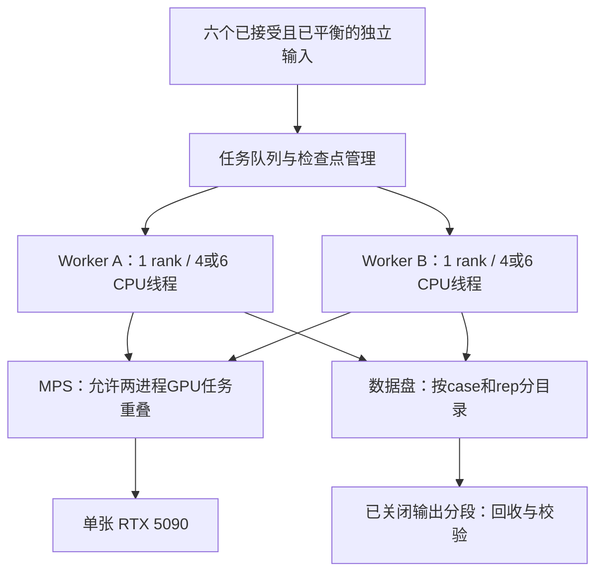

# Gpr2 TWF154 单张 5090 吞吐量验证与排程方案

> 历史计划：2026-10-09 用户选择清理对应性能材料，本文的原性能依据已移除；本计划不再作为当前执行入口。原路径仅供历史回查，处置记录见[清理记录](../../../docs/research/local-remote-sync-20261008/cleanup-execution-20261009.json)。

> Source: 输入与性能复核（原本地文件已按用户选择清理）、本机实测及预算（原本地文件已按用户选择清理）。
> As of: 2026-10-05。
> Allowed use: 后续调优执行设计；本文件不是已运行记录，也不扩展此前一小时短测授权。
> Update trigger: 新输入、实测吞吐、容器资源或版本改变。

当前输入选择以 [两组 ascr3 的 lid 重构合同](../../../experiments/md-simulation/results/gpr2-twf154-n84v-v368r/input-selection-20261005/README.md) 为准：新坐标尚待生成。**等一下这轮硬件调优统一使用 N84V–ascr18 的同一原生产 TPR；双任务使用其两个隔离副本。** 这些副本不是科学重复，不推进正式生产完成量。新 lid 重构版需准备好后再单独实测；不再把旧原始 V368R 当作新选择的替身。

## 推荐架构

保留固定 A（2025.4 / CUDA 12.9 / external MPI）作为比较基线。先把单轨迹的邻居表与 CPU 配置调好，再用两个独立单 rank worker 通过 MPS 共享同一张 GPU；只有实测总吞吐更高且检查正常，才把双 worker 设为批量默认。若 MPS 不可用或无收益，队列降为一个 worker。



这是两个独立进程共享 GPU 的设计。未来正式队列的每条轨迹保留各自全长受体、pose、拓扑、速度、随机种子和检查点，不做交换，也不把同一条轨迹的分段当成重复。当前选择读取 [selection.json](../../../experiments/md-simulation/results/gpr2-twf154-n84v-v368r/input-selection-20261005/selection.json)；原始输入追溯读取 历史六组映射（原本地文件已按用户选择清理）。本轮为公平比较调度方式，两个进程都从同一 N84V TPR 起点开始。

## 固定边界与待查问题

物理模型保持原 TPR：完整膜/水/离子、CMAP、2 fs、原 h-bonds/LINCS、温压耦合、精度模式以及所有输出频率。允许改变运行时 offload、CPU 分配、邻居表间隔与其自动缓冲半径；保留原 Verlet 能量/压力误差容限，不手动缩小缓冲、不增大误差容限。PME 自动调优策略与基线一致，记录最终参数，不另做 cutoff/PME 扫参。

CMAP 仍在 CPU，不能假定 CUDA Graphs 已可用。原日志还显示 update groups 不可用；当前单 rank GPU update 已跑通，不把一条轨迹拆为多个 rank 来绕过瓶颈。GROMACS B 的升级与回归测试是独立候选，不混入这一轮矩阵，也不假设可以去除 CMAP 限制。

正式批量生产之前，沿原报告完成 CPU/GPU 单点势能差分解复核；保持坐标、拓扑和实际 PME 参数相同，排查能量项定义/短程修正而非仅比较总量，覆盖多个固定帧。确认力一致性、短跑稳定与正确续接。两组 ascr3 的新 lid 变体必须重新准备；其余准备未完成的原始组合补齐 NPT/约束释放。性能短测只能形成性能结论，不能转为机制生产。

## CPU 与 GPU 工作分配

1. 每次重新部署先核验 GPU UUID/驱动、库与 sm_120、cpuset、cgroup `cpu.max`、`cpu.stat` 限流、物理核/SMT 拓扑及 GPU NUMA 亲和。配额上限以 cgroup 为准；可见 CPU 数不能代替可用算力，绑核也不能保证共享主机上的核独占。
2. 单 worker 从 8 OpenMP 线程开始。双 worker 从 2×6 线程开始，分别放在不重叠的物理核，余下配额留给驱动/MPS、日志与回收；若限流或竞争明显，再试 2×4。实际核号根据现场拓扑产生，不能照搬“0–5/6–11”。
3. 采用一种明确的亲和管理方式，例如 Linux affinity 限定各 worker 可用核，OpenMP `OMP_PLACES=cores`、`OMP_PROC_BIND=close`，GROMACS `-pin off`；检查最终线程绑定，避免 MPI、OpenMP、GROMACS 多方重绑。单 worker 对照也采用同样规则。
4. GPU 保留 `-nb gpu -pme gpu -bonded gpu -update gpu` 作为初始配置。CMAP 与邻居搜索仍需 CPU。有时间线证据且时间允许时，只比较一次 `-bonded cpu -update gpu`，不重复旧的 CPU update 大范围扫参。
5. A 为 external MPI：每个 worker 单独启动一个 MPI rank（当前已测入口可单进程直接运行），不传 `-ntmpi`。将来单独测试 B/thread-MPI 才使用对应的 `-ntmpi 1`。进程、目录和输出前缀全部独立。

## MPS 配置与恢复

先确认本容器允许使用 `nvidia-cuda-mps-control`，并检查是否已有服务/其他 GPU 任务。服务器与客户端限定同一 GPU UUID 和相同 UID，使用本任务独立的 pipe/log 目录；按本机已装控制工具的接口启动，记录版本。无需引入新版 MPS v3 接口或修改宿主 compute mode/驱动。

初筛不强制每任务“50% GPU”，让 MPS 自由调度，避免预先人为切断可用计算资源。保留两个任务不用 MPS 的同条件对照。服务可用性与兼容性必须在本机短跑验证；GeForce 架构层面的支持不保证租用容器权限。监控时 MPS 可能统一显示为 server 进程，仍须分别从两个 GROMACS 日志/检查点测进度。[MPS 使用条件](https://docs.nvidia.com/deploy/mps/latest/when-to-use-mps.html)

每条短测用有限步数和 `maxh` 正常结束，不用强杀充当计时停止。MPS 同卡客户端可能受某个任务的 GPU fatal error 波及，队列遇到该类错误停止分派并核查两条轨迹检查点；不把有异常的一段计入有效生产。收尾仅清理本任务服务，遵守实例是否关机的当前约定。

## 有限验证顺序

这是用户要求准备的下一轮上卡方案，本次尚未执行。建议总上限 **60 分钟，按 2.88 元/小时约 2.88 元计算费用**，开机等待、超出窗口的传输与镜像收费另计。安装、lid 重构和重新平衡不塞入该窗口，不自动加时。最多八个性能窗口，每次总运行约 6.2 分钟、排除启动后至少 5 分钟；预留约 10 分钟给环境、数值、续跑及回收。时间不足时省略可选配置，优先复测赢家。

| 顺序 / 输出名 | 输入与配置 | 要回答的问题 |
|---|---|---|
| 0 / preflight | 固定帧数值检查；环境/配额/磁盘核验；必要时 20 秒时间线 | 对新数值异常停止；已知势能差单列跟踪，不把测速当作关闭该问题 |
| 1 / s8_n100_r1 | 1×8 线程；nstlist=100；nb/PME/bonded/update GPU | 当次原配置基线 |
| 2 / s8_n200_r1 | 同起点；nstlist=200 | 邻居表间隔收益 |
| 3 / s8_n300_r1 | 同起点；nstlist=300 | 较大缓冲是否抵消搜索收益 |
| 4 / single_best_r2 | 重复前三项赢家；绑定相同 8 个物理核 | 确定有两次稳定窗口的串行基线 |
| 5 / pair_nomps_r1 | 同一 N84V TPR 两副本；2×6 线程；采用串行最佳 nstlist | 普通并发合计速度 |
| 6 / pair_mps_r1 | 同样两个副本、2×6 线程与 nstlist；启用 MPS | 仅改变 MPS 后是否提升 |
| 7 / pair_candidate_r1 或 pair_best_r2 | 若 2×6 限流明显，试 MPS 2×4；否则复测并发赢家 | 资源竞争和重复性 |
| 8 / pair_candidate_r2（按需） | 只有 2×4 成为新赢家而尚缺复测时执行 | 新赢家必须有第二窗口，不能只挑一次最高值 |

第 0 项若耗时过多，优先完成正确性与原配置复测，缩小后续矩阵。最多八个性能窗口，不追加第九个；第 8 项没有触发则不做。单任务 4/16 线程、bonded CPU/update GPU、B 环境与 CUDA Graphs 不在这轮核心矩阵，避免改变多个因素并耗尽时限。后续其他真实输入、新 lid 重构版的复核另排，不把此轮结果写成六组已测。

## 可直接使用的运行参数

使用已固定 A 的 `gmx_mpi` 单 rank 入口，不传 `-ntmpi`。原数据盘若仍保留，基准 TPR 位于 `/root/autodl-tmp/drylab-benchmark-20261005/inputs/raw_n84v_ascr18/production.tpr`；上机先验证存在且 SHA256 为 `20109d0cb35c209d4d4bc834b65990bde71a9bcda2e4eb95c5e5df71da70ac97`。如果实例由镜像新建、数据盘没有该文件，从保留包重新上传该 TPR 并校验；不传历史轨迹。独立 TPR 已包含 mdrun 所需生产输入；单点诊断另按原验证材料准备。

每次创建带日期/时间的独立根目录，下面按表中输出名分目录。现场依据 CPU/NUMA 拓扑选择互不重叠的物理核列表，分别记为 `probe_cpus_single`（8 核）、`probe_cpus_a`（6 核）、`probe_cpus_b`（6 核），不得硬编码宿主核号或把可见的 128 线程当成配额。命令模板如下，变量均由本轮 preflight 填入：

```bash
# Run in a new empty per-window/per-worker directory.
# probe_cpus, probe_threads, probe_nstlist, probe_tpr come from the plan row.
taskset -c "$probe_cpus" env \
  OMP_NUM_THREADS="$probe_threads" OMP_PLACES=cores OMP_PROC_BIND=close \
  OPENBLAS_NUM_THREADS=1 \
  /opt/drylab/gromacs-2025.4/bin/gmx_mpi mdrun \
  -s "$probe_tpr" -deffnm bench \
  -ntomp "$probe_threads" -pin off \
  -nb gpu -pme gpu -bonded gpu -update gpu \
  -nstlist "$probe_nstlist" -nsteps 2000000 -resetstep 40000 -maxh 0.105 \
  > console.log 2>&1
```

`maxh` 的正常停止约在 374 秒，另有启动/收尾开销；固定 2,000,000 步是第二层有限步数边界。40,000 步 reset 后需确认调优已结束且仍有至少 300 秒稳定计时，否则该窗标为无效，不用于选最优。两个并发进程各有独立 `worker_a/worker_b` 目录，输入相同，但输出不会相互覆盖；各自后台启动并保存 PID，分别检查退出码，不能仅用不带 PID 的 `wait` 推断两个都成功。

MPS 对照在 UUID 相同、线程相同、原输入与 nstlist 相同的条件下运行。启动前排除已存在的他人服务，设置本轮独立 `CUDA_MPS_PIPE_DIRECTORY` 与 `CUDA_MPS_LOG_DIRECTORY`；将 `CUDA_VISIBLE_DEVICES` 设为经现场确认的那张 GPU UUID，并让两个客户端继承同样环境。使用本机支持的 `nvidia-cuda-mps-control -d`，核对 server/client 连接证据后计时；环境变量存在不等于已连上 MPS。客户端全部正常退出后只停止本轮 daemon，保留实例。

每窗每 5 秒记录 GPU 利用率、功耗、频率、显存、两个 PID 的 CPU 使用、cgroup 限流及日志最新 Step/Time。同时保存实际命令、亲和列表、版本、TPR 哈希、开始/结束 UTC 时间和带时间戳的 `run_state_events.tsv`。出现 LINCS、非有限能量、fatal 或某 worker 异常退出，停止该窗并保留日志，不以剩下一个 worker 的速度冒充双任务吞吐。

邻居表初始 TPR 设置 20，本机基线实际调到 100。测试 `-nstlist 100/200/300` 时保留 `verlet-buffer-tolerance=0.005`、`verlet-buffer-pressure-tolerance=0.5`，检查日志中实际间隔和自动 `rlist`，原温压/能量计算间隔不变。改变列表间隔无需改动原 TPR 文件；每次记录命令与 TPR 哈希。检查温度、压力、盒形/面积和能量项是否出现异常，短窗无异常不等于长期平衡已证明。

诊断采样只保留启动/PME 调优后约 20 秒 CUDA 时间线，区分 GPU kernel、H2D/D2H 复制、CPU 计算和等待。可用 Nsight Systems 的 delayed capture、CUDA/NVTX trace 并关闭 CPU 采样；先检查实际安装版本支持的参数，不能为此无边界安装。采样结束要让有限步数模拟正常退出，避免 profiler 默认退出策略杀死任务。带 profiler 的数据不用来报价。[Nsight Systems 命令说明](https://docs.nvidia.com/nsight-systems/UserGuide/index.html#example-single-command-lines)

普通计时窗口排除启动、JIT 与 PME 调优，目标至少 5 分钟；原 resetstep=40,000 只是原基线配置，需查看调优是否真的在窗口前结束。记录实际步数/时间，不仅读取 GROMACS 单个平均数字。对并发使用两个任务都稳定后的同一墙钟区间，不能相加不同时段的最佳速度。

## 采用规则、排程与成本

双任务共同窗口的吞吐为：

`Q = 86400 × (窗口内轨迹 A 推进 ns + 轨迹 B 推进 ns) / 窗口墙钟秒数`。

与当次已优化串行实测比较：两次稳定窗口均无数值/续接异常，收益超过观测波动且至少约 5%，才引入 MPS 运维复杂度。5% 为项目操作余量，并非精密显著性检验。若总吞吐没有改善，即便 GPU 利用率显示接近 100%，仍采用串行。

正式队列只有准备和用途检查通过的条目才能进入。双 worker 结束一条即补下一条，避免整批等最慢任务；每组有自己的计时估计，尾部只有一个任务时用单任务速度。固定配对、同时起跑且无换队列时，结束时间应按 `max(24×剩余ns_A/r_A, 24×剩余ns_B/r_B)`，不能套用两份独占速度。正式 E2 抵扣需要重新取得一致、可续接且用途可接受的数据。

仅为算式示例：若将来实测两条并发各 230 ns/day，合计 460，而六组均能维持该吞吐，600 ns 的理想生产时间约 31.3 h、生产算力约 90.2 元（2.88 元/h），再加准备、队列尾部及收尾。这不是预测、实测或新的正式报价；未获得新数据前预算继续使用原串行结果。

队列输出保留原频率。输入、轨迹与缓存放数据盘，软件和通用入口留系统盘；只回收已关闭的分段或一致检查点包，SHA256 确认后才能释放远端空间。后台回收限线程/IO，避免与两 worker 争用 16 核配额，且需要实际链路速度估计。50 GB 数据盘不能一次容纳十八条完整产物。镜像不含研究轨迹，镜像保存状态/ID 必须另行确认，不能从“软件环境已固定”推断已保存成功。

本方案不把 GPU 利用率设为唯一目标：主指标是六组完成时间与有效生产 ns/元，同时保留科学用途限制。所引是实际输入、日志和官方方法资料；被引为项目 INDEX、计划索引、性能复核报告。
