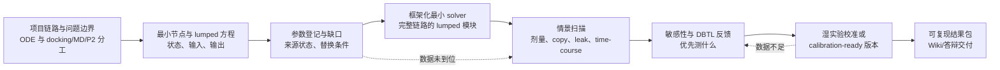

# ODE v0.1 任务完成逻辑与阶段大纲

> 本计划以 [项目索引](../../../docs/INDEX.md)、[P0 信号通路 ODE](../../../docs/modeling/P0-signal-pathway-ode.md) 和 [Reporter 架构决策](../../../docs/decisions/004-reporter-output-architecture.md) 为依据。当前已完成通路结构、参数状态和湿实验校准需求整理；尚无 ODE solver、config 或 plots。本计划不把 docking `ΔG` 转为 `Kd/EC50`，也不把未校准参数写成项目结论。

## 完成逻辑

ODE 的完成不是“先写一段代码，再补解释”，而是下面这条可回退、可校准的链路。每一步的输出都是下一步的输入；如果上游证据或实验数据不足，模型必须保留参数状态，而不是用猜测值填补。

### 本轮责任模式

- **关志远（主执行）**：统筹模型规格、lumped 方程、参数状态、最小 solver 与最终演示。
- **杨若兮（协作执行）**：共同完成整体结构理解、方程生物学解释、参数缺口/湿实验接口，并负责测试与运行说明。
- **黄鑫淇（跟进审核）**：以同步学习、记录问题和边界核查为主；暂时不承担第一周关键代码交付，但在 7 月 19 日检查“未校准参数未被写成结论”和最小 solver 的运行记录。

核心感应组、通路工程组和背景调研组按需提供事实输入；本轮第一周的执行与验收以以上三人为准。

## 阶段与时间表

| 阶段 | 时间 | 进入条件 | 本阶段核心活动 | 输出 | 完成门槛 |
|---|---|---|---|---|---|
| 0. 第一周：理解与框架化最小 solver | 7/13–7/19 | 已有通路拓扑、reporter 架构和参数状态资料 | 理解干实验结构；解释 lumped 方程；列参数缺口；按完整项目链路搭建可展开的最小 solver | 一页总体结构图、方程解释、参数缺口表、最小 solver 与 smoke test | solver 包含 `ascr -> Gpr -> chimeric Gpa1 -> MAPK -> sTF -> GAL -> color` 的模块接口；可在单一情景下生成整条链路的示意 time-course；不使用 docking 分数作动力学常数 |
| 1. 情景扫描与结果包 | 7/20–8/2 | 最小 solver 与参数状态表通过审核 | 增加可读 config、测试和运行说明；执行剂量、1/2/4 copy、leak 与时间扫描 | `experiments/ode-model/` 下的 CSV、图和运行记录 | 每张图注明情景参数和边界；结果称为情景模拟，不称项目检测限或最终最优构型 |
| 2. 敏感性与 DBTL 反馈 | 8/3–8/16 | 情景结果可重复 | 分析哪些参数主导输出；把不确定性转成实验优先级 | 敏感性/可识别性结果、model–experiment feedback 表 | 每个高影响参数都有实验或文献替换路径；P2/HP 参数与 ODE 参数分开 |
| 3. 校准准备与数据回填 | 8/17–9/6 | 已定义可测 readout 与参数映射 | 回填可获得的 dose-response、basal/no-ligand、time-course、表达/定位和 coupling 数据 | 校准记录、不确定性说明，或 calibration-ready 版本 | 只有可追溯实验数据可升为 calibrated；数据未到位时不虚构校准结果 |
| 4. Wiki/组会交付与审阅 | 9/7–9/20 | 结果、参数和反馈表可追溯 | 整理方法、参数状态、情景结果、反馈闭环和局限性 | Wiki/答辩材料、可复现运行包 | 代码、config、CSV、图和结论可相互回溯；清楚标明结论层级 |
| 5. 冻结缓冲与修订 | 9/21–Wiki freeze 前 | 完成跨组审阅 | 处理证据、表达和可复现性问题 | 冻结版本 | 不新增未验证结论；只处理审阅和一致性问题 |

## 跨阶段不可省略的质量门

1. **参数边界**：Vina/SwissDock `ΔG` 只用于候选场景和相对排序，绝不直接转换为 `Kd`、`EC50`、`kon/koff`。
2. **Reporter 边界**：已确认的是 `sTF -> GAL 多拷贝放大 -> 色素显色` 拓扑；具体色素、整合位点、实际 copy number、gain、leak 和显色时间仍需校准。
3. **结果边界**：无项目 wet-lab calibration 时，所有曲线均为 `scenario prior` 模拟；不能称为最终检测限、最终最佳构型或项目 ROI。
4. **可复现性**：每个结果必须能回到代码版本、config、参数状态和输出 CSV。
5. **DBTL 接口**：模型必须输出“下一项最值得测什么”，而不只给图；湿实验和 HP/P2 的问题表是阶段 3 起的正式交付物。

## 关键依赖

| 依赖输入 | 提供方 | ODE 如何使用 |
|---|---|---|
| 受体/突变体候选、双通道方向、WT 对照 | 核心感应组 | 定义 receptor-ligand 情景集合；不生成固定亲和力常数 |
| 嵌合 Gpa1、reporter 构型、copy number 与读出条件 | 通路工程组 | 定义 coupling、gain/leak、时间响应的参数接口和实验替换条件 |
| dose-response、无 ligand、time-course、表达/定位、coupling 数据 | 核心感应组 + 通路工程组 | 用于校准或约束参数；数据不足时维持情景模拟 |
| 成本、部署、检测周期、干预和支付意愿 | 背景调研组 / HP | 供 P2 使用；不进入 ODE 方程 |
