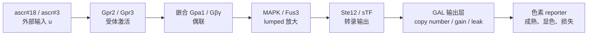

# 本项目 ODE 四阶段交付工作页

> 用途：第一次 ODE 组会、成员自查和湿实验/HP 对接的可直接使用材料。
>
> 事实和边界的权威来源是 [P0 信号通路 ODE](../../modeling/P0-signal-pathway-ode.md)、[Reporter 架构决策](../../decisions/004-reporter-output-architecture.md)、[P2 经济效益模型](../../modeling/P2-economic-benefit.md) 和 [P2 HP 问卷](../../modeling/P2-economic-benefit-hp-questionnaire.md)。本页只将它们组织为学习和沟通交付物，不新增参数结论。

## 开始前：目前进度与本轮边界

| 已经具备 | 尚未具备 | 本轮四阶段的正确目标 |
|---|---|---|
| 酵母 STE2 通路的节点拓扑、参数状态标签、湿实验校准需求；`sTF -> GAL 多拷贝放大 -> 色素显色` 输出架构 | 可运行的 ODE solver、参数配置、模拟 CSV/曲线、项目自身的 dose-response 或 time-course 校准值 | 让成员能讲清模型、画出最小节点、读懂方程，并把未知参数准确交给湿实验或 HP |

因此，下面的方程是**教学用的 lumped 骨架**，不是已经校准的项目预测模型。特别要守住三条线：

1. 不把 docking `ΔG` 换算成 `Kd`、`EC50` 或速率常数。
2. Reporter 架构已确认，不等于其 gain、leak、copy number、显色时间已确认。
3. ODE 描述检测信号的动态；成本、支付意愿和 ROI 属于 P2/HP，不能塞进通路方程。

---

## 阶段 1：能讲清楚

### 交付物：5 分钟口头讲稿

**0:00–0:45｜为什么需要 ODE**

我们的目标不是只问“加了 ascr 后会不会有颜色”，而是要问信号从 ligand 进入细胞后，何时放大、何时显色、背景会不会自己升高。这个过程有明显的时间顺序：受体激活、G protein 偶联、MAPK 放大、转录输出、GAL 放大和色素成熟。因此需要 ODE——常微分方程——来描述每个关键量怎样随时间变化。

**0:45–1:40｜ODE 的五个对象**

ODE 可以写成 `dx/dt = f(x, t, p, u)`。`x` 是状态变量，例如活化的 G protein、MAPK 和可见颜色；`u` 是外部输入，例如 ascr#18/ascr#3 浓度和 copy-number 场景；`p` 是控制快慢与强弱的参数，例如半激活浓度、偶联效率、gain、leak 和显色速率；`dx/dt` 表示一个状态在当前时刻变化多快；求解后得到的是随时间变化的曲线，而不是一个静态数字。

**1:40–2:40｜它怎样对应本项目**

我们先不展开所有蛋白反应，而是把通路压缩为 ligand、Gpr2/Gpr3、嵌合 Gpa1/Gβγ、MAPK/Fus3、Ste12/sTF、GAL 输出层和色素 reporter。这样既保留了“输入—放大—输出”的因果链，又不会一次引入无法校准的大量速率常数。未来模型要用这种骨架比较不同 ligand 浓度、不同 copy number 和不同 leak 情景下的时间曲线、剂量响应和动态范围。

**2:40–3:35｜现在完成了什么、没有完成什么**

目前完成的是建模准备层：拓扑、文献证据边界、参数状态和湿实验需求已经整理；输出层架构也已经确认。尚未完成的是 solver、项目最终参数表、模拟曲线和项目自身的校准。因此今天展示的是“模型应该怎样问问题”，不是“模型已经给出了检测限或最佳构型”。docking 结果可用于选择要比较的 receptor-ligand 场景，但不能提供真实 `Kd` 或 `EC50`。

**3:35–4:25｜ODE 与 P2 的区别**

ODE 是动态反应网络：给定 ligand、通路和 reporter 参数，问颜色输出如何随时间变化。P2 是 deterministic cost-accounting：给定作物价格、损失、检测成本和干预效果，计算 break-even 或 ROI。两者的接口是检测性能：经校准后，ODE/湿实验可以提供响应时间、动态范围、漏背景风险和可判读窗口；P2 仍需要 HP 回收当地成本、部署密度、支付意愿和干预数据。

**4:25–5:00｜下一步与结论**

所以本阶段最重要的不是给未知参数填一个看似精确的数，而是明确哪些数必须测。湿实验优先补 dose-response、无 ligand 背景、time-course、表达/定位和 chimeric Gpa1 偶联；HP 优先补本地检测成本、采样密度、时间收益、干预成本和支付意愿。数据到位后，情景参数才能被替换为校准参数，再进入 solver 和 P2 的定量联动。

### 验收答案

| 问题 | 应答要点 |
|---|---|
| 为什么不能只做静态输入输出表？ | 受体激活、通路放大、表达与显色都存在延迟、饱和和降解。 |
| `x`、`p`、`u` 分别是什么？ | 随时间变化的状态、控制方程的参数、外部给定输入。 |
| ODE 现在是否已经能给出检测限？ | 不能。当前尚无 solver 和项目校准数据；只能说明未来应如何评估。 |
| P2 和 ODE 有何不同？ | P2 算成本收益；ODE 算信号通路的时间动态。 |

---

## 阶段 2：能画出本项目模型

### 交付物 A：最小节点图



### 交付物 B：节点、输入、输出与未知参数表

| 节点 | 最小数学表示 | 上游输入 | 下游输出 | 仍未知、需跟进的参数 | 当前参数状态 |
|---|---|---|---|---|---|
| ascr#18/#3 | 外部输入 `L` | 实验给定浓度 | 受体激活函数 | 样品背景与真实浓度范围 | 扫描范围 `scenario prior`；真实范围待实验 |
| Gpr2/Gpr3 | `R_active(L)` | `L`、受体/突变体标签 | 活化受体 | `K_L/EC50-like`、Hill、Emax、basal activity | docking 常数 `do-not-use`；项目数值待校准 |
| 嵌合 Gpa1/Gβγ | `G_on` | `R_active` | 有效下游信号 | `k_couple`、失活速度、basal leak | 项目 coupling `wet-lab required` |
| MAPK/Fus3 | `M` | `G_on` | 转录激活输入 | 有效激活/失活速率、延迟 | 拓扑可固定；项目数值暂不能固定 |
| Ste12/sTF | `TF(M)` | `M` | GAL 输出层的转录活性 | 背景、最大输出、阈值、Hill、延迟 | 函数形式可用；项目数值待校准 |
| GAL 输出层 | `Prod(TF,N)` | `TF`、copy number `N` | reporter 生产速率 | `N`、gain、leak、饱和、延迟 | 架构已确认；数值 `wet-lab required` |
| 色素 reporter | `C(t)` | `Prod` | 可见读数 | 生产/成熟/损失速率、判读窗口、noise | `wet-lab required` |

**读图检查：** ligand 是输入，不必先作为状态变量；`G_on`、`M`、`C` 是第一版最需要随时间追踪的状态；每个未知参数都必须有来源状态，不能因为“需要一个数字”就从 docking 或别的底盘直接搬用。

---

## 阶段 3：能读懂方程骨架

### 交付物 A：输入、状态、参数与输出

| 数学对象 | 本项目中的内容 | 例子 |
|---|---|---|
| 输入 `u` | 实验或场景预先设定 | ascr#18/#3 浓度、`N = 1/2/4` copy 情景、模拟时间 |
| 状态 `x` | 需要随时间计算的量 | `G_on`、`M`、可选 `P`、最终 `C` |
| 参数 `p` | 决定快慢、幅度、饱和或背景的量 | `K_L`、Hill、`k_couple`、gain、leak、`k_color_loss` |
| 输出 `y` | 用于回答设计问题的读数 | `C(t)`、剂量响应、背景 leak、动态范围、可判读时间窗 |

### 交付物 B：教学用 lumped 方程骨架

```text
R_active = basal_R + E_R * L^n_R / (K_L^n_R + L^n_R)

dG_on/dt = k_couple * R_active * (1 - G_on) - k_g_off * G_on

dM/dt = k_m_on * G_on * (1 - M) - k_m_off * M

TF = basal_TF + E_TF * M^n_TF / (K_TF^n_TF + M^n_TF)

Prod = leak_out + copy_number * gain_out * TF / (K_out + TF)

dC/dt = k_color_prod * Prod - k_color_loss * C
```

### 逐项解释

| 式子 | 正项/功能项表示什么 | 负项表示什么 | 它回答的项目问题 |
|---|---|---|---|
| `R_active(L)` | ligand 增加时的 Hill 型受体激活；`basal_R` 保留无 ligand 背景 | 无显式负项，因其是代数激活函数 | 哪个浓度区间会开始触发受体？ |
| `dG_on/dt` | 受体以 `k_couple` 激活尚未激活的 G protein 池 | `k_g_off * G_on` 表示失活/恢复 | 嵌合 Gpa1 是否会把信号有效接入？ |
| `dM/dt` | `G_on` 驱动剩余 MAPK 池活化 | `k_m_off * M` 是去磷酸化/恢复 | 通路放大速度和延迟怎样影响下游？ |
| `TF(M)` | MAPK 转为饱和型转录输出 | 无显式负项，背景由 `basal_TF` 表达 | 上游信号怎样变成转录输入？ |
| `Prod(TF,N)` | `N * gain_out` 放大 sTF 输入 | 无显式降解，表示瞬时生产速率 | 放大是否同时抬高无 ligand 背景？ |
| `dC/dt` | 颜色按有效生产/成熟速度累积 | `k_color_loss * C` 汇总降解、稀释或衰减 | 多久能读色、何时达到稳态？ |

这里的 `(1 - G_on)` 和 `(1 - M)` 表示“尚未被激活的可用池”。变量可先归一化到 0–1，以降低初版模型对绝对分子数的依赖。若 time-course 显示表达与显色明显错开，再把最终一步拆成 `P -> C` 两个状态，而不是现在就虚构更多速率常数。

### 交付物 C：参数状态表

| 参数组 | 目前能怎样使用 | 绝不能怎样使用 |
|---|---|---|
| 酵母 STE2/MAPK 拓扑、状态变量类别 | 作为 `fixed from source` 的结构 | 把未完成单位/动力学映射的 Shaw/Kofahl/Yi 数值直接填入模型 |
| docking 候选标签、双通道方向、相对排序 | 用来选择要比较的 receptor-ligand 场景 | 将 Vina/SwissDock `ΔG` 直接变成 `Kd`、`EC50`、`kon/koff` |
| `K_L`、Hill、Emax、受体 basal activity | 作为明确标注的 `scenario prior` 扫参 | 声称是本项目真实亲和力或检测限依据 |
| `k_couple`、G protein basal leak | 参考异源偶联文献的宽先验 | 迁移为项目嵌合 Gpa1 的确定值 |
| GAL gain/leak/copy number、显色时间 | 做设计情景和敏感性分析 | 认为架构确认已经给出这些数值 |

---

## 阶段 4：能跟进参数缺口

### 交付物 A：给湿实验/通路工程组的问题清单

| 要问的问题 | 最小实验或记录 | 回收的 ODE 参数/用途 |
|---|---|---|
| WT Gpr2、WT Gpr3 和优先突变体对 ascr#18/#3 的剂量响应分别是什么？ | 同一 chassis/reporter 背景；无 ligand、低/中/高浓度；记录重复、单位和 OD/growth | `K_L/EC50-like`、Hill、Emax、A/B 场景差异 |
| 无 ligand 时的输出与噪声有多高？ | 阴性对照、空载/无受体对照、同一判读时间 | basal activity、`leak_out`、假阳性风险 |
| reporter 本身是否可用？ | pathway 或 alpha-factor 正控；记录 readout 与培养条件 | 区分通路失效与 reporter 失效；确定 Emax/动态范围 |
| 信号和颜色何时出现、何时稳定？ | minutes–hours 早期点与 2–8 h 判读窗；低/近 EC50/高 ligand 条件 | `k_*` 的时间尺度、成熟延迟、可判读窗口 |
| 受体有没有表达并正确定位到膜？ | tagged receptor imaging、flow 或 western（以实际条件为准） | 区分表达/trafficking 失败与活化/偶联失败 |
| 嵌合 Gpa1 是否能功能偶联？ | 同一 chassis/reporter 的功能 assay；路径正控与选定 ligand | `k_couple`、basal Gβγ leak、是否能使用该链路 |
| 输出层具体构型是什么？ | 确认色素类型、整合位点、有效 copy number、培养/判读条件 | `N`、gain、leak、显色/损失参数；不能只记录“GAL 放大” |

### 交付物 B：给 HP/P2 的最小问题清单

这些问题**不进入 ODE 方程**，而是让 P2 的成本收益模型能消费已校准的检测性能。完整访谈题库和字段定义见 [P2 HP 问卷](../../modeling/P2-economic-benefit-hp-questionnaire.md)。

| 要问的问题 | 应记录的单位/证据 | P2 参数 |
|---|---|---|
| 优先作物、地区、线虫类型、种植面积是什么？ | 作物-地区-线虫组合；亩/ha | `crop_scenario`、`area` |
| 正常年份产量和近期销售价格是多少？ | kg/亩 或 t/ha；元/kg 或元/t；年份 | `baseline_yield`、`crop_price` |
| 现在的检测怎样采样、多少钱、多快出结果？ | 点/亩、样本数、元/样本、小时/天；含人工和运输 | `deployment_density`、`current_detection_cost`、`lab_turnaround` |
| 若在播前/早期得到结果，能提前多久并改变什么行动？ | 天/周/生育期；具体动作 | `early_time_gain`、`decision_threshold` |
| 各项干预的药剂、人工、机械、轮作或种子成本是多少？ | 元/亩或元/ha；成本组成 | `intervention_cost` |
| 这些干预在早发现时能避免多少损失？ | 产量/收入损失比例及条件 | `intervention_efficacy`、`late_loss_rate` |
| 对误报、漏报和实验室复核的容忍度如何？ | 典型案例、额外损失或需复核的阈值 | `false_negative_cost`、`decision_threshold` |
| 能接受的检测价格和主要采用障碍是什么？ | 元/次、元/亩或元/季；保存/运输/培训/合规顾虑 | `farmer_wtp`、`adoption_barrier` |

### ODE–P2 接口检查

| 由 ODE/湿实验提供（校准后） | 仍由 HP/P2 回收 | 不能做的推断 |
|---|---|---|
| 响应时间、背景 leak、动态范围、剂量响应、可判读窗口、检测性能的不确定性 | 检测成本、部署密度、实验室周期、干预成本/效果、作物价格、支付意愿 | 用未校准 ODE 参数直接推出 ROI；用 docking 分数推出经济效益 |

---

## 四阶段验收记录

| 阶段 | 本页交付物 | 通过标准 |
|---|---|---|
| 1 | 5 分钟讲稿和四个问答 | 能说清动态过程、`x/p/u`、ODE 与 P2 的界线 |
| 2 | 节点图和节点表 | 每个节点都有输入、输出与未知参数，且没有把 ligand 输入误写成必需状态 |
| 3 | 方程、逐项解释和参数状态表 | 能解释正项、负项、饱和项，并明确哪些数不能固定 |
| 4 | 湿实验与 HP/P2 提问清单 | 能将参数归到正确团队，不把经济参数混入 ODE |

下一阶段才是工程实施：在上述湿实验数据、参数状态与可识别性策略准备就绪后，再创建 solver、参数配置、结果 CSV 和情景图；那时的每一张图都必须标注参数来源及其校准状态。
