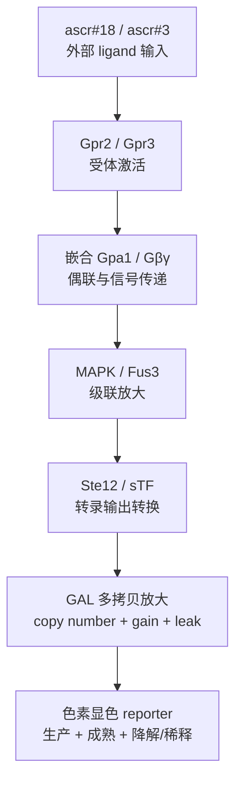
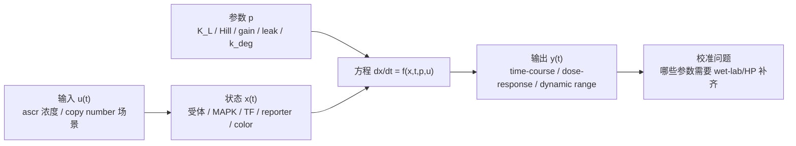

# 本项目 ODE 建模数学原理入门：从通用 ODE 到项目简化节点

> 面向读者：团队中完全没有 ODE 建模经验、但需要理解本项目为什么要用 ODE、ODE 在数学上如何描述通路、哪些参数需要湿实验/HP 后续补齐的成员。
>
> 文档性质：团队数学原理入门 + 项目 ODE 思路解释。它不是代码实现教程，不要求成员写 Python 或理解仓库代码实现；也不是 iGEM Wiki 正式稿，不给出最终参数表，不宣称已有项目校准结果。
>
> 当前边界：本项目当前未写 ODE solver，仓库中尚无可运行的 ODE 工程产物。本文只讲数学层面的原理、节点简化和参数含义；未来代码实现属于下一阶段，不是本文学习目标。

## 使用方式：团队 ODE 数学理解路线

这份文档不是单纯的 ODE 科普，也不是正式技术规格书。它的用途是让团队中 ODE 初学者从零开始，理解本项目的数学建模逻辑：输入是什么、状态变量是什么、参数是什么、输出是什么，以及为什么这些参数需要湿实验或 HP 继续补齐。

建议把学习目标分成四个阶段，不要一开始试图把所有章节都变成代码或工程任务。

| 阶段 | 读完后应该能做到什么 | 推荐先读章节 | 阶段产出 |
|---|---|---|---|
| 阶段 1：能讲清楚 | 能用自己的话解释 ODE、状态变量、参数、输入、输出、数值求解 | 0-4、10 | 5 分钟口头讲解：ODE 和 P2 经济模型有什么不同 |
| 阶段 2：能画出本项目模型 | 能把生物链路压缩成建模节点，并说出每个节点的未知参数 | 5、8、9、10 | 一张节点图 + 一张“节点/输入/输出/未知参数”表 |
| 阶段 3：能读懂方程骨架 | 能解释 lumped ODE 中每一项的生物含义，但不会把示意数值当定论 | 6、7、11、12 | 方程骨架解释 + 参数状态表 |
| 阶段 4：能跟进参数缺口 | 能判断哪些参数来自文献、哪些只是情景假设、哪些必须湿实验/HP 回收 | 8、9、10、15 | 湿实验/HP 参数问题清单 |

每个阶段都要守住三条边界：

1. 不把 docking `ΔG` 换算成 `Kd/EC50`。
2. 不把 reporter 架构确认误读成 reporter 参数确认。
3. 不把 P2 经济模型参数混进 ODE 方程；HP 参数是经济模型和部署模型的输入，ODE 只提供检测性能、时间响应、动态范围等可被 P2 消费的接口。

### 阶段验收问题

如果一个新人读完后还不能回答下面的问题，就先不要进入后续参数分工或 wet-lab 对接：

| 问题 | 目标答案方向 |
|---|---|
| ODE 的 `x`、`p`、`u` 分别是什么？ | `x` 是状态变量，`p` 是参数，`u` 是外部输入 |
| 为什么本项目不能只做静态输入输出表？ | 因为信号通路、reporter 表达和显色都有时间过程 |
| docking 结果在 ODE 里能做什么？ | 只能提供候选标签、方向和场景优先级，不能直接提供真实亲和力 |
| reporter 架构已确认意味着什么？ | 拓扑已定为 sTF -> GAL 多拷贝放大 -> 色素显色，但 gain/leak/copy/time-course 仍待校准 |
| 最终数学模型最小要描述什么？ | time-course、dose-response、copy-number sensitivity、leakage/dynamic range |
| HP 组需要什么，为什么它不属于 ODE 本体？ | HP 需要成本、部署、支付意愿和 ROI 参数；ODE 只给检测性能相关输入 |

### 不要过度学习的内容

为了尽快建立数学直觉，初学者第一轮不需要：

- 推导完整数值分析理论。
- 展开 Ste20/Ste11/Ste7/Fus3 每一个反应和速率常数。
- 读完所有 Shaw/Kofahl/Yi/Fan 原文再开始理解本项目。
- 学 Python、SciPy、仓库目录结构或任何代码实现细节。
- 在没有湿实验数据时追求“最终参数表”。

第一轮的正确目标是：能理解少量 lumped 状态变量如何表达本项目通路，能解释每个方程项的含义，能指出哪些参数还不能固定。

## 新人第一次交付页

这份文档读完后的第一次交付，不是写任何程序，也不是整理一份更长的读书笔记。第一次交付要证明新人已经理解“这个项目为什么需要 ODE、数学上怎么把通路压缩成节点、哪些参数还不能乱填”。

建议第一次交付只包含四件东西：

| 交付物 | 内容 | 合格标准 |
|---|---|---|
| 5 分钟口头讲解 | 解释 ODE 和 P2 经济模型的区别 | 能说清 ODE 是动态通路模型，P2 是 ROI/cost-accounting 算术模型 |
| 一张节点图 | ligand -> receptor -> G protein -> MAPK -> sTF -> GAL -> color | 每个节点都有输入、输出和未知参数 |
| 一个方程骨架说明 | 用文字解释第 6 节每个状态变量和方程项 | 不需要最终数值，但要能说出每个参数从哪里校准 |
| 一张参数问题清单 | 列出要问湿实验/HP 的参数缺口 | ODE 参数和 P2/HP 参数分开，不混进同一个模型 |

第一次组会可以按这个顺序汇报：

1. 先讲“本项目 ODE 的输入、状态、参数、输出分别是什么”。
2. 再讲“为什么要把真实通路压缩成 7 个节点”。
3. 再讲“哪些数学输出可以帮助讨论检测限、动态范围和 leak”。
4. 最后讲“需要湿实验和 HP 回收哪些参数”。

第一次组会不要求展示任何代码。只要能把方程、节点、参数缺口讲清楚，就已经达到本文目标。

## 0. 先给一句话答案

本项目的 ODE 建模最终应该是一个“动态信号通路预测系统”：

```text
ascr 输入浓度
  -> Gpr2/Gpr3 受体激活
  -> 嵌合 Gpa1/Gβγ 信号传递
  -> MAPK/Fus3 级联放大
  -> Ste12/sTF 转录输出
  -> GAL 多拷贝放大
  -> 色素显色 reporter 输出
```

它的核心不是一张静态表，而是一组常微分方程。数学上，它用状态变量描述 reporter、MAPK、转录输出等量随时间变化；用参数描述受体激活、偶联效率、放大倍数、背景泄漏和显色速度；用输出曲线讨论剂量响应、检测限、动态范围、copy number 对输出的影响、背景泄漏对假阳性的影响。

这描述的是最终目标形态，不是当前完成状态。当前真实状态见第 8、9、14 节：项目已完成模型准备层，但没有 ODE solver、最终参数表或项目自身 dose-response/time-course 校准数据。

## 1. ODE 到底是什么

ODE 的英文全称是 ordinary differential equation，中文叫常微分方程。

“常微分方程”听起来很抽象，但本质很简单：它描述一个量会怎样随时间变化。

例如，一个细胞里的蛋白浓度 `X` 会随时间变化。它可能被不断生产，也会被降解。那么我们可以写：

```text
dX/dt = 生产速度 - 降解速度
```

这里的 `dX/dt` 可以读成：“X 每单位时间变化多少”。如果 `dX/dt` 是正数，说明 X 在增加；如果是负数，说明 X 在减少；如果接近 0，说明 X 基本达到稳态。

最通用的 ODE 写法是：

```text
dx/dt = f(x, t, p, u)
```

这个式子可以拆开理解：

| 符号 | 含义 | 在生物模型中的例子 |
|---|---|---|
| `x` | 状态变量，也就是模型正在追踪的东西 | 活化受体比例、Gβγ 浓度、Fus3PP 水平、reporter 蛋白量 |
| `t` | 时间 | 0 min、10 min、1 h、8 h |
| `p` | 参数 | 结合强度、降解速率、Hill 系数、最大表达量、背景泄漏 |
| `u` | 外部输入 | ascr#18 浓度、ascr#3 浓度、copy number 设定 |
| `f` | 规则函数 | 由生物反应机制和假设写出来的数学公式 |
| `dx/dt` | 状态变化速度 | reporter 每分钟增加多少、Fus3 活化速度有多快 |

所以 ODE 模型的核心工作就是：决定有哪些状态变量 `x`，它们怎么互相影响，然后写出每个变量的变化速度。

## 2. 为什么生物通路适合用 ODE

细胞信号通路不是“一次输入，一次输出”的静态过程。它通常有时间过程：

- 配体先结合受体。
- 受体激活 G protein。
- G protein 释放下游信号。
- MAPK 逐级磷酸化。
- 转录因子启动表达。
- reporter 蛋白被生产、成熟、稀释或降解。
- 最后颜色逐渐出现。

每一步都有“快慢”和“饱和”。ODE 正好适合描述这些动态过程。

### 2.1 例子一：生成 - 降解

假设 reporter 蛋白 `R` 以速度 `k_prod` 被生产，并以速度 `k_deg * R` 被降解：

```text
dR/dt = k_prod - k_deg * R
```

含义：

- `k_prod` 越大，reporter 增加越快。
- `k_deg` 越大，reporter 消失越快。
- `R` 越多，降解总量越大。
- 当 `k_prod = k_deg * R` 时，`R` 不再明显变化，达到稳态。

这类方程可以描述 reporter 蛋白、mRNA、活化蛋白等很多节点。

### 2.2 例子二：激活 - 失活

假设一个蛋白有未激活态 `A_inactive` 和激活态 `A_active`。上游信号会把它激活，磷酸酶或 GTP 水解会让它失活：

```text
dA_active/dt = k_on * signal * A_inactive - k_off * A_active
```

含义：

- `signal` 越强，激活越快。
- 未激活蛋白越多，可被激活的“原料”越多。
- 已激活蛋白越多，失活总量越大。

这类结构可用于 G protein 激活、MAPK 磷酸化、转录因子激活。

### 2.3 例子三：结合 - 解离

假设配体 `L` 和受体 `R` 结合形成复合物 `LR`：

```text
dLR/dt = kon * L * R - koff * LR
```

含义：

- `kon` 是结合速率。
- `koff` 是解离速率。
- `L * R` 表示配体和空受体都有，结合才发生。
- `LR` 越多，可解离的复合物越多。

在本项目中，真实的 `kon/koff/Kd/EC50` 不能从 docking 分数直接得到。本项目明确不把 docking ΔG 换算 Kd/EC50。ODE 中的配体结合/激活参数要么来自后续 wet-lab dose-response，要么先作为扫描变量。

## 3. 数值求解是什么

很多 ODE 方程无法靠手算一步得到答案。数值求解器就是用一系列小时间步，近似计算状态变量随时间变化的工具。本文不要求成员学习求解器代码，只需要理解“方程给出变化速度，数值求解把变化速度累积成时间曲线”。

从数学上看，求解需要四样东西：

1. 初始状态：例如一开始 reporter 为 0，Fus3 未激活。
2. 参数：例如受体半激活浓度、reporter 降解速率、copy number。
3. 输入：例如 ascr#18 浓度为 `1e-6 M`。
4. 时间范围：例如从 0 到 8 小时。

数值求解会做的事情是：

```text
t = 0 时，计算所有变量变化速度
向前走一个很小的时间步
更新变量
再计算新的变化速度
继续向前推进
直到模拟结束
```

最终得到的不是一个数，而是一条时间曲线。例如：

- 0 min：reporter 还没有产生。
- 30 min：MAPK 已经有响应，但颜色还不明显。
- 2 h：reporter 开始积累。
- 8 h：颜色达到较稳定读数。

这就是为什么 ODE 和 P2 经济模型不一样。P2 经济模型是 deterministic cost-accounting，更多是固定输入参数到成本、收益、ROI 的算术映射；ODE 是动态反应网络，关注“信号如何随时间传递和放大”。

## 4. 本项目为什么需要 ODE

本项目的目标是做一个基于 GPCR 的线虫早期检测系统。信号链路简化后是：

```text
ascr 输入
  -> Gpr 受体
  -> 嵌合 Gpa1
  -> 酵母 MAPK
  -> sTF/GAL 放大
  -> 色素显色
```

湿实验最终想知道的是：这个系统能不能在田间有用。

ODE 要回答的是中间的动态定量问题：

| 问题 | ODE 具体要给什么 |
|---|---|
| 最低能检测多少 ascr？ | 检测限或可判读窗口 |
| 高浓度和低浓度是否能区分？ | 剂量响应曲线和动态范围 |
| 没有 ligand 时会不会自己变色？ | basal leak 和假阳性风险 |
| GAL 放大要多强？ | 放大倍数和 copy number 扫参 |
| 1 copy、2 copy、4 copy 差别多大？ | copy-number sensitivity |
| 哪些参数最值得先做湿实验？ | 灵敏度分析和 feedback 表 |

注意，ODE 不是用来证明 Gpr2/Gpr3 结构正确的。结构、候选位点、对接方向主要来自 docking/MD/文献。ODE 接收这些候选标签，建模它们如果在湿实验中有不同激活强度，会导致怎样的动态输出。

## 5. 本项目生物链路如何简化成 ODE 节点

真实细胞里每一步都很复杂。第一版 ODE 不应该把所有分子细节都展开，否则参数太多，湿实验也无法校准。更合理的做法是“保留关键节点，合并过细过程”。

当前 reporter 架构已确认：

```text
异源 Gpr2/3 -> 嵌合 Gpa1 -> MAPK 级联 -> sTF -> GAL 多拷贝放大 -> 色素显色
```

下面把它拆成适合初版 ODE 的节点。



下面每个节点都按同一套模板阅读：

| 模板项 | 读的时候要问什么 |
|---|---|
| 生物学含义 | 这一段在真实细胞里对应什么过程？ |
| ODE 简化表示 | 最小数学模型里把它压缩成变量、函数还是参数？ |
| 输入 | 这个节点从上游接收什么？ |
| 输出 | 这个节点传给下游什么？ |
| 未知参数 | 哪些量还不能固定？ |
| 当前状态 | 这些未知量是 `fixed from source`、`scenario prior`、`literature prior`、`wet-lab required` 还是 `do-not-use`？ |

### 5.1 节点 1：ascr#18/ascr#3 输入

ascr#18 和 ascr#3 是外部输入，不是细胞内动态变量。

可以把它们理解成实验者设置的 ligand 浓度：

```text
u = [L18, L3]
```

其中：

- `L18` 是 ascr#18 浓度。
- `L3` 是 ascr#3 浓度。
- 单位可能是 M、uM、nM，最终要统一。

在模拟时，常见做法是扫一系列浓度：

```text
1e-12 M, 1e-11 M, ..., 1e-3 M
```

但这些只是扫描情景，不是项目最终检测范围。真实范围要由湿实验和样品背景决定。

| 模板项 | 本节点填写 |
|---|---|
| 生物学含义 | 外部 ascaroside 信号进入检测系统 |
| ODE 简化表示 | 外部输入 `u = [L18, L3]`，不是动态状态变量 |
| 输入 | 实验设置的 ascr#18/ascr#3 浓度 |
| 输出 | 传给 Gpr2/Gpr3 激活函数的 ligand 浓度 |
| 未知参数 | 真实样品浓度范围、背景基质、实验浓度梯度 |
| 当前状态 | 扫描范围是 `scenario prior`；真实检测范围是 `wet-lab required` |

### 5.2 节点 2：Gpr2/Gpr3 受体激活

Gpr2/Gpr3 是异源表达在酵母膜上的受体。它们感受到 ascr 后，进入活化状态。

第一版 ODE 可以不直接写完整的 `kon/koff` 结合模型，而用 Hill 型激活函数表示：

```text
Activation = basal + Emax * L^n / (K_L^n + L^n)
```

每个符号的意思：

| 符号 | 含义 |
|---|---|
| `Activation` | 受体激活强度，常归一化到 0 到 1 |
| `basal` | 没有 ligand 时的基础活性，也就是背景泄漏 |
| `Emax` | 最大可达到的激活强度 |
| `L` | ligand 浓度 |
| `K_L` | 半激活浓度，类似 EC50/Kc 的角色 |
| `n` | Hill coefficient，描述响应曲线陡峭程度 |

对初学者来说，可以把它理解成一条 S 型曲线：

- ligand 很低时，输出接近 basal。
- ligand 接近 `K_L` 时，输出开始明显上升。
- ligand 很高时，输出接近 Emax。

本项目边界：

- docking 可以告诉我们哪些 Gpr 突变体值得测、哪个偏 ascr#18 或 ascr#3。
- docking 不能直接告诉真实 `K_L`、`EC50`、`Emax`。
- 所以 `K_L`、Hill、Emax、basal activity 当前是 `scenario prior` 或 `wet-lab required`。

| 模板项 | 本节点填写 |
|---|---|
| 生物学含义 | 异源 Gpr2/Gpr3 感受 ascr 后进入活化状态 |
| ODE 简化表示 | Hill 型受体激活函数 `Activation(L)` |
| 输入 | `L18`、`L3`、receptor/mutant 场景标签 |
| 输出 | `Receptor_active` 或归一化受体活性 |
| 未知参数 | `K_L/EC50-like`、Hill、Emax、basal activity、ligand efficacy |
| 当前状态 | docking 分数是 `do-not-use`；受体参数是 `scenario prior` 或 `wet-lab required` |

### 5.3 节点 3：嵌合 Gpa1/Gβγ 偶联

酵母原生 STE2 通路里，Gpa1 是 Gα 蛋白。激活后的 GPCR 会影响 G protein 状态，释放 Gβγ，下游再推动 MAPK 通路。

本项目不是直接使用真菌内源 Gα，而是用嵌合 Gpa1：主体适配酵母通路，C 端嫁接真菌 Gα C 端，以帮助异源 Gpr2/Gpr3 和酵母信号系统对接。

初版 ODE 可以把这一段简化为：

```text
dG_on/dt = k_couple * Receptor_active * (G_total - G_on) - k_deact * G_on
```

含义：

- `G_on` 是活化的 G protein/Gβγ 信号水平。
- `G_total - G_on` 是还没被激活的池子。
- `k_couple` 是受体到 G protein 的偶联效率。
- `k_deact` 是失活或恢复速度。

本项目中，`k_couple` 非常关键，因为异源 Gpr 和嵌合 Gpa1 是否真正适配酵母，需要湿实验验证。文献只能给异源 GPCR-Gpa1 系统的先验风险和量级，不能直接固定本项目 Gpr2/Gpr3 与具体 chimeric Gpa1 的偶联效率。

| 模板项 | 本节点填写 |
|---|---|
| 生物学含义 | 受体激活后通过嵌合 Gpa1/Gβγ 把信号接入酵母通路 |
| ODE 简化表示 | `G_on` 动态变量，描述有效 G protein/Gβγ 信号 |
| 输入 | `Receptor_active` |
| 输出 | `G_on`，传给 MAPK lumped 节点 |
| 未知参数 | `k_couple`、`k_deact`、basal Gβγ leak、chimeric coupling efficiency |
| 当前状态 | 异源偶联文献是 `literature prior`；项目 coupling 是 `wet-lab required` |

### 5.4 节点 4：MAPK/Fus3 级联

酵母 STE2 通路下游包括 Ste20、Ste11、Ste7、Fus3 等级联。完整展开会有很多变量和速率常数。

第一版可以先用 lumped activation，也就是把多级 MAPK 压缩成一个有效节点：

```text
dM/dt = k_mapk_on * G_on * (1 - M) - k_mapk_off * M
```

含义：

- `M` 表示归一化的 MAPK/Fus3 活化水平。
- `G_on` 越高，MAPK 激活越快。
- `1 - M` 表示还有多少 MAPK 可被激活。
- `k_mapk_off` 表示去磷酸化或恢复。

为什么可以先这样简化？

完整 MAPK 通路当然更真实，但参数很多。当前项目还没有足够湿实验数据支撑每一级都独立校准。初版目标是回答系统级问题：输入 ascr 到最终 reporter 输出之间的大致动态关系、放大和泄漏风险。先 lumped，再在数据充足时展开，是更稳妥的路径。

| 模板项 | 本节点填写 |
|---|---|
| 生物学含义 | Gβγ 信号触发 Ste20/Ste11/Ste7/Fus3 等 MAPK 级联 |
| ODE 简化表示 | `M` 一个 lumped MAPK/Fus3 活化状态 |
| 输入 | `G_on` |
| 输出 | `M`，传给 Ste12/sTF 转录输出 |
| 未知参数 | `k_mapk_on`、`k_mapk_off`、有效放大强度、响应延迟 |
| 当前状态 | 通路拓扑可 `fixed from source`；初版速率多为 `scenario prior` 或待文献映射 |

### 5.5 节点 5：Ste12/sTF 转录输出

MAPK 激活后会影响 Ste12 等转录输出。本项目 reporter 架构中，Ste12 相关输出会接到 sTF，即 Ste12 PRD-Gal4DBD 类融合转录因子输出层。

初版可写成：

```text
TF_activity = basal_TF + E_TF * M^n_TF / (K_TF^n_TF + M^n_TF)
```

含义：

- `M` 是 MAPK 活化水平。
- `TF_activity` 是转录输出强度。
- `basal_TF` 是无信号时转录背景。
- `E_TF` 是最大转录输出。
- `K_TF` 和 `n_TF` 控制曲线位置和陡峭度。

这里的重点不是复刻每一个转录因子结合细节，而是把“MAPK 信号如何转换成表达输出”建成一个可校准模块。

| 模板项 | 本节点填写 |
|---|---|
| 生物学含义 | MAPK 活化转换为 Ste12/sTF 介导的转录输出 |
| ODE 简化表示 | `TF_activity` 代数函数或动态状态变量 |
| 输入 | MAPK 活化水平 `M` |
| 输出 | sTF/GAL 输出层接收的转录活性 |
| 未知参数 | `basal_TF`、`E_TF`、`K_TF`、`n_TF`、转录延迟 |
| 当前状态 | 输出函数形式可作为模型结构；项目数值是 `scenario prior` 或 `wet-lab required` |

### 5.6 节点 6：GAL 多拷贝放大

reporter 架构确认了 sTF -> GAL 多拷贝放大 -> 色素显色。这里的 GAL 多拷贝放大是输出层增益模块。

对 ODE 来说，关键不是一句“用了 GAL 放大”，而是要把它变成可扫描参数：

| 参数 | 直观含义 |
|---|---|
| `copy_number` | reporter/GAL 输出模块有效拷贝数，例如 1/2/4 copy 情景 |
| `gain` | 每单位 sTF 活性产生多少 reporter 转录输出 |
| `leakage` | 没有 ligand 时 GAL 输出层自己漏出多少背景表达 |
| `saturation` | 输出层是否会饱和 |
| `response_delay` | 从转录启动到 reporter 可见需要多久 |

一个简化表达可以是：

```text
Reporter_production = leakage + copy_number * gain * TF_activity / (K_out + TF_activity)
```

含义：

- `copy_number` 越高，理论输出越强。
- `gain` 越高，放大越强。
- `leakage` 越高，无 ligand 时也可能变色，带来假阳性。
- `K_out` 控制输出层从低响应到饱和的转折。

重要边界：

- “GAL 多拷贝放大”是 ODE 中要扫描和校准的设计变量。
- 它不等于已经决定使用 2μ 质粒。
- 它也不等于已经固定某个 copy number。
- 具体色素、整合位点、实际 copy number、gain、Kc/Hill/Emax、显色时间都仍然是 `wet-lab required` 或 scenario sweep。

| 模板项 | 本节点填写 |
|---|---|
| 生物学含义 | sTF 驱动 GAL 输出层，把上游信号放大到 reporter 表达 |
| ODE 简化表示 | `Reporter_production` 函数，显式包含 `copy_number`、`gain`、`leakage` |
| 输入 | `TF_activity`、copy-number 场景 |
| 输出 | reporter 生产速率 |
| 未知参数 | copy number、gain、leakage、saturation、response delay |
| 当前状态 | reporter 架构已确认；具体数值是 `scenario prior` 或 `wet-lab required` |

### 5.7 节点 7：色素显色 reporter

最终用户看到的是颜色，但颜色不是瞬间出现。它可能涉及：

- reporter mRNA 产生。
- reporter 蛋白翻译。
- 蛋白折叠或色素合成。
- 色素成熟。
- 细胞生长造成稀释。
- 蛋白或色素降解。

第一版可以用一个 reporter 状态变量 `C` 表示可见颜色强度：

```text
dC/dt = k_color_prod * Reporter_production - k_color_loss * C
```

含义：

- `C` 是颜色强度或归一化 reporter 输出。
- `k_color_prod` 是 reporter 生产和显色的有效速度。
- `k_color_loss` 包含降解、稀释、信号衰减等。

如果后续发现显色成熟有明显延迟，可以拆成两级：

```text
dP/dt = protein_production - k_mature * P - k_deg_P * P
dC/dt = k_mature * P - k_loss_C * C
```

| 模板项 | 本节点填写 |
|---|---|
| 生物学含义 | reporter 生产、成熟、显色、稀释或降解 |
| ODE 简化表示 | `C` 表示可见颜色或归一化 reporter 输出；必要时拆成 `P -> C` 两级 |
| 输入 | `Reporter_production` |
| 输出 | 最终可视化读数 `C(t)` |
| 未知参数 | `k_color_prod`、`k_color_loss`、成熟延迟、细胞生长稀释、判读时间窗口 |
| 当前状态 | 方程形式可作为最小数学结构；显色时间和读出参数是 `wet-lab required` |

这里 `P` 是未成熟 reporter，`C` 是成熟可见颜色。第一版是否拆开，取决于 time-course 数据是否显示“表达”和“显色”之间有明显滞后。

## 6. 本项目最小数学模型骨架可以长什么样

下面是一种教学用的最小数学骨架。它不是最终定论公式，也不是代码规格；它的作用是帮助初学者看懂“哪些量随时间变化、每一项代表哪一步生物过程”。

### 6.1 状态变量

| 状态变量 | 含义 | 是否建议最小模型包含 |
|---|---|---|
| `G_on` | 嵌合 Gpa1/Gβγ 信号活化水平 | 是 |
| `M` | MAPK/Fus3 活化水平 | 是 |
| `TF` | Ste12/sTF 输出活性 | 可作为代数函数或状态变量 |
| `P` | reporter 蛋白或色素前体 | 可选 |
| `C` | 可见颜色/reporter 输出 | 是 |

其中 receptor activation 可以先作为 ligand 的代数函数，而不是状态变量：

```text
R_active(L) = basal_R + E_R * L^n_R / (K_L^n_R + L^n_R)
```

### 6.2 方程骨架

一个简化版本可以写成：

```text
R_active = basal_R + E_R * L^n_R / (K_L^n_R + L^n_R)

dG_on/dt = k_couple * R_active * (1 - G_on) - k_g_off * G_on

dM/dt = k_m_on * G_on * (1 - M) - k_m_off * M

TF = basal_TF + E_TF * M^n_TF / (K_TF^n_TF + M^n_TF)

Prod = leak_out + copy_number * gain_out * TF / (K_out + TF)

dC/dt = k_color_prod * Prod - k_color_loss * C
```

这里每个变量都可以归一化到 0 到 1，降低初版参数难度。

### 6.3 为什么这种骨架适合入门版

它保留了本项目最重要的因果链：

```text
ligand -> receptor -> G protein -> MAPK -> TF -> reporter -> color
```

它也保留了最需要决策的工程变量：

- ligand 半激活位置。
- basal leak。
- coupling efficiency。
- MAPK 放大强度。
- output gain。
- copy number。
- reporter 显色时间。

但它没有一开始展开所有底层细节。这样做的好处是：

- 参数数量可控。
- 初学者能读懂。
- 能尽早生成剂量响应和敏感性图。
- 可以和湿实验数据逐步对接。
- 后续有数据时再把某个 lumped 节点拆开。

## 7. 最终完整形态在数学上包含哪些对象

虽然未来模型会被工程化成程序、表格和图，但本文不要求成员理解这些实现。数学层面只需要知道：一个完整 ODE 模型不是“一个公式”，而是一组对象共同组成的系统。



### 7.1 输入

输入是模型外部给定的条件。在本项目中，最核心输入是：

| 输入 | 数学角色 | 项目含义 |
|---|---|---|
| ascr#18 浓度 | ligand input | 给 Gpr2/Gpr3 的外部刺激 |
| ascr#3 浓度 | ligand input | 另一个候选 ligand 刺激 |
| copy number 场景 | design input | GAL 多拷贝放大强度的设计变量 |
| 时间范围 | simulation window | 从加入 ligand 到观察显色的时间 |

这些输入不是模型自己算出来的，而是人为设定、实验设定或后续场景分析给定的。

### 7.2 状态变量

状态变量是模型随时间追踪的量。初学者可以把它们理解成“通路里正在变化的读数”。

| 状态变量 | 代表什么 | 为什么要追踪 |
|---|---|---|
| `G_on` | 受体激活程度 | ligand 输入首先影响它 |
| `P` | G protein / 下游偶联信号 | 连接受体和 MAPK |
| `M` | MAPK/Fus3 活化水平 | 表示级联放大 |
| `TF` | Ste12/sTF 输出强度 | 连接信号通路和转录输出 |
| `R` | reporter 蛋白或前体 | 表示表达积累 |
| `C` | 显色强度 | 最终肉眼或仪器读数 |

真实生物系统当然更复杂。最小 ODE 模型的价值在于：先追踪这些关键状态，判断系统是否有可用的动态范围和可校准参数。

### 7.3 参数

参数是控制方程行为的数字。它们回答“这个过程有多强、多快、多漏、多容易饱和”。

| 参数类型 | 控制什么 | 本项目例子 |
|---|---|---|
| 半响应参数 | 多高 ligand 浓度能激活一半响应 | `K_L` 或 EC50-like |
| 曲线形状参数 | 剂量响应是平缓还是陡峭 | Hill |
| 最大响应参数 | 输出最高能到多少 | Emax |
| 速率参数 | 激活、失活、产生、降解有多快 | `k_on`、`k_off`、`k_deg` |
| 放大参数 | 下游信号比上游强多少 | coupling、gain、copy number |
| 泄漏参数 | 没有 ligand 时是否也有背景输出 | basal activity、reporter leak |
| 显色参数 | 颜色出现和消失的速度 | color maturation/loss |

参数是最容易误用的地方。当前很多参数只能是 `scenario prior` 或 `wet-lab required`，不能被写成项目定论。

### 7.4 方程

方程把“输入、状态、参数”连起来，描述每个状态变量的变化速度。

最核心的形式是：

```text
dx/dt = f(x, t, p, u)
```

在本项目中，这句话可以翻译成：

```text
每个通路节点当前变化多快
= 这个节点现在的状态
  + 当前时间
  + 通路参数
  + ascr 输入和 copy number 场景
共同决定的结果
```

读懂方程时，不要先问“这个数字是多少”。先问：

1. 这个变量代表哪一步生物过程？
2. 这个正项代表什么生成、激活或放大？
3. 这个负项代表什么降解、失活或稀释？
4. 这个参数现在是文献先验、情景假设，还是必须湿实验测量？

### 7.5 输出

输出是模型最终拿来讨论项目问题的结果。数学输出可以是曲线、表格或阈值，但初学者第一轮只需要理解它们的含义。

| 输出 | 数学含义 | 项目问题 |
|---|---|---|
| time-course | `C(t)` 或其他状态随时间变化 | 多久能看到颜色？ |
| dose-response | 不同 ascr 浓度对应的输出 | 哪个浓度范围最敏感？ |
| dynamic range | 高信号和背景之间的差距 | 能不能区分有无信号？ |
| basal leak | 无 ligand 时输出有多高 | 假阳性风险多大？ |
| copy-number sensitivity | copy number 改变时输出怎么变 | 放大会不会也放大背景？ |
| detection window | 可判读的浓度和时间窗口 | 湿实验应在哪些条件下测？ |

### 7.6 参数状态

成员需要理解参数状态，而不是把所有参数都当成“已经知道的数”。

| 状态标签 | 含义 | 能不能当最终结论 |
|---|---|---|
| `fixed from source` | 来源中已经固定的结构、定义或方法 | 只能固定对应范围内的事实 |
| `literature prior` | 可作为文献先验或参考范围 | 不是本项目定论 |
| `scenario prior` | 为了理解趋势而设定的情景 | 只是扫参假设 |
| `wet-lab required` | 必须由本项目湿实验校准 | 不能固定 |
| `do-not-use` | 不得进入数值模型 | 禁止作为参数 |

这张表比代码结构更重要。初学者如果只记住一件事，就是：**ODE 不是把未知参数伪装成已知参数，而是明确暴露哪些未知量最需要被校准。**

## 8. 本项目当前已经完成了什么

当前已经完成的是“数学建模准备层”，不是 solver 实现层，也不是最终定量模型。

| 已完成内容 | 数学意义 |
|---|---|
| 通路结构整理 | 知道要把哪些生物过程压缩成状态变量和节点 |
| reporter 架构确认 | 输出链路为 sTF -> GAL 多拷贝放大 -> 色素显色 |
| 文献证据矩阵 | 知道哪些结构、方法、先验和边界有来源 |
| 参数状态标签 | 知道哪些参数能参考、哪些必须校准、哪些不能用 |
| docking 输入边界 | docking 只给候选标签、方向、相对排序，不给真实 Kd/EC50 |
| 湿实验需求表 | 知道哪些数学参数需要 dose-response、time-course、basal/no-ligand、表达定位等 readout |

这一步很重要，因为如果没有这层准备，后续很容易把错误参数写成“模型结论”。

## 9. 当前缺口是什么

当前缺口可以分成三层。成员需要理解这些缺口的数学意义，不需要现在解决代码实现。

### 9.1 数学参数缺口

当前没有最终项目参数表。尤其不能固定：

- Gpr2/Gpr3 对 ascr#18/ascr#3 的真实 `Kd`、`kon/koff`、`EC50-like`。
- Gpr2/Gpr3 与嵌合 Gpa1 的真实 coupling efficiency。
- reporter gain。
- basal leak。
- GAL 输出层实际 copy number 效果。
- 色素 reporter 的显色时间和成熟动力学。

这些不是“暂时忘了填的数字”，而是模型中最关键的未知量。

### 9.2 实验校准缺口

当前需要湿实验补：

- WT Gpr2/Gpr3 和候选突变体的 dose-response。
- 无 ligand 阴性对照，测 basal leak。
- 正控，例如 pathway 正控或 alpha-factor 背景下 reporter 可用性。
- time-course，测响应延迟和显色窗口。
- 表达/定位，区分“受体没表达/没上膜”和“受体不响应”。
- chimeric Gpa1 functional coupling，确认偶联是否真的发生。

这些实验不是 ODE 之外的杂事，而是 ODE 参数从情景假设变成项目校准值的入口。

### 9.3 当前工程状态边界

仓库当前没有可运行的 ODE solver。这个事实需要知道，但它只是项目状态边界，不是本文的学习任务。

对本文读者来说，这只意味着一件事：当前所有数学讨论仍是目标形态和参数准备，不是已经完成的可运行模型。

## 10. 初学者不要混淆的几件事

### 10.1 ODE 不是静态算术表

静态算术表通常是：

```text
输入几个参数 -> 算一个结果
```

ODE 是：

```text
输入初始状态、参数、外部刺激 -> 描述一段时间内所有状态如何变化
```

所以 ODE 关注的是过程和时间，不只是最终数值。

### 10.2 docking 分数不是亲和力常数

docking 可以帮助排序候选、分析可能接触、提供 Channel A/B 偏向线索。但 docking 分数不能直接当真实 `Kd`、`EC50`、`kon/koff`。

本项目必须保留这条边界：

```text
不把 docking ΔG 换算 Kd/EC50
```

如果未来数学模型需要 ligand 激活参数，应先把它作为情景参数理解，等 wet-lab dose-response 后替换。

### 10.3 reporter 架构确认不等于 reporter 参数确认

当前已经确认的是：

```text
sTF -> GAL 多拷贝放大 -> 色素显色
```

但仍未确认：

- 具体色素类型。
- 整合位点。
- 实际 copy number。
- reporter gain。
- basal leak。
- Kc/EC50-like。
- Hill。
- Emax。
- 显色时间。

所以不能把 reporter 当作已经完整定量。

### 10.4 GAL 多拷贝放大不是固定 2μ 质粒

“多拷贝放大”在 ODE 中应理解为变量或设计情景：

```text
copy_number = 1, 2, 4, ...
```

它不等于：

- 已经决定使用 2μ 质粒。
- 已经知道真实 copy number。
- 已经知道 copy number 和输出强度严格线性。

这些都要通过湿实验和数学敏感性分析共同判断。

### 10.5 P2 经济模型和 ODE 不是同一种模型

P2 经济效益模型是 deterministic cost-accounting。它的问题是：

```text
给定作物价格、损失率、检测成本、干预成本、干预效果 -> 算 ROI 或 break-even
```

ODE 的问题是：

```text
给定 ascr 浓度、通路参数、reporter 参数 -> 描述细胞信号和颜色输出随时间变化
```

所以二者都可以叫“模型”，但建模原理不同。

### 10.6 术语速查表

初学者第一轮不需要背公式，但需要把下面这些词分清楚。它们是理解 ODE 数学原理和项目参数缺口的基础。

| 术语 | 在本文中的意思 |
|---|---|
| state variable | 模型随时间追踪的状态，例如 `G_on`、`M`、`C` |
| parameter | 控制方程行为的数，例如 `K_L`、Hill、gain、leak |
| input | 外部给定条件，例如 ascr 浓度、copy number 场景 |
| output | 模型最终读数，例如 reporter 输出、颜色强度、动态范围 |
| numerical solving | 根据变化速度近似得到时间曲线 |
| time-course | 随时间变化的曲线或表，例如 `C(t)` |
| steady state | 变量基本不再变化时的状态，不等于真实实验终点一定已到 |
| dose-response | 不同 ligand 浓度对应的输出关系 |
| dynamic range | 高信号和背景信号之间的可区分范围 |
| basal leak | 没有 ligand 时的背景输出 |
| lumped model | 把多个细节反应压缩成一个有效节点的简化模型 |
| sweep | 扫描一组参数或输入，看输出如何变化 |
| calibration | 用项目自己的实验数据替换或拟合模型参数 |
| scenario prior | 暂时用于理解趋势的情景假设，不是最终结论 |
| wet-lab required | 必须等本项目湿实验测量后才能固定 |

### 10.7 不要问错问题

很多 ODE 新手会把问题问成“能不能直接给一个最终数值”。这通常会把模型带偏。下面这些是本项目里最容易出现的 XY 问题。

| 容易问错的问题 | 更应该问的问题 | 为什么 |
|---|---|---|
| docking `ΔG` 能不能换算成 EC50？ | docking 能帮我们定义哪些 receptor-ligand 场景？ | docking 可用于候选和机制线索，不提供本项目真实亲和力 |
| 哪个 copy number 最优？ | copy number 增加时，signal 和 leak 是否一起增加？ | 放大可能同时放大背景，必须看动态范围 |
| GAL 多拷贝放大是不是已经定量确定？ | GAL 输出层的 gain、leak、饱和和显色时间要怎么校准？ | 架构确认不等于参数确认 |
| ODE 能不能直接告诉湿实验做哪个 mutant？ | ODE 能不能比较不同候选在假设响应参数下的输出窗口？ | ODE 消费候选标签和参数情景，不替代 docking/MD/湿实验选择 |
| 什么时候能给最终检测限？ | 哪些参数到位后，检测限才能从情景模拟变成校准结果？ | 当前缺 dose-response、noise、time-course 等校准数据 |
| ODE 能不能直接算 ROI？ | ODE 能给 P2 经济模型哪些检测性能输入？ | ROI 属于 P2 deterministic cost-accounting，不属于 ODE 方程 |
| 要不要一开始复刻完整 Shaw/Kofahl 模型？ | 最小数学模型需要保留哪些节点才能回答检测限、动态范围和 leak？ | 第一轮目标是理解可校准骨架，不是做最大复杂度模型 |
| 没有最终参数是不是不能学习 ODE？ | 能不能先理解参数状态和情景分析？ | 可以先理解数学结构，但必须标清参数状态 |

## 11. 最终数学对象应该怎样组织

本文不要求成员理解文件目录。只要在数学上能把模型拆成下面五类对象，就已经够进入团队讨论。

| 对象 | 要回答的问题 | 本项目例子 |
|---|---|---|
| 输入 | 外部给模型什么刺激或设计条件？ | ascr#18/ascr#3 浓度、copy number |
| 状态 | 哪些量随时间变化？ | `G_on`、`P`、`M`、`TF`、`R`、`C` |
| 参数 | 哪些数字控制变化快慢和强弱？ | `K_L`、Hill、gain、leak、`k_deg` |
| 方程 | 每个状态变量的变化速度由什么决定？ | 生成-降解、激活-失活、放大-饱和 |
| 输出 | 用什么结果回答项目问题？ | time-course、dose-response、dynamic range、basal leak |

如果一个成员能用这五类对象复述本项目 ODE，就已经理解了数学层面的最终形态。

## 12. 最终数学模型应该回答哪些问题

当 ODE 模型完整后，它至少应该能回答：

1. 在一组假设参数下，ascr#18 或 ascr#3 的浓度升高时，reporter 输出如何变化？
2. 哪个浓度范围内输出最敏感？
3. 没有 ligand 时背景输出有多高？
4. copy number 从 1 到 2 到 4 时，输出增强多少，背景是否也增强？
5. 如果 reporter gain 提高，检测限是否改善，还是主要增加 leak？
6. 哪些参数最影响检测限？
7. 哪些参数必须优先湿实验测量？
8. 在当前未校准情况下，哪些结论只能作为情景模拟，不能作为项目定论？

这些问题都是数学建模问题，不要求成员写代码才能理解。

## 13. 阶段复习检查清单

本节不是第二套路线路径。真正的学习顺序以上方“团队 ODE 数学理解路线”为准。这里仅作为每个阶段结束时的自查清单。

| 阶段 | 自查问题 | 合格标准 |
|---|---|---|
| 阶段 1：能讲清楚 | 能不能不用公式解释 ODE 为什么适合本项目？ | 能说出“随时间变化”“状态变量”“参数”“输入输出” |
| 阶段 2：能画出模型 | 能不能画出 ligand -> receptor -> G protein -> MAPK -> TF -> reporter -> color？ | 能给每个节点写出输入、输出、未知参数 |
| 阶段 3：能读懂骨架 | 能不能解释第 6 节每条方程对应哪一步生物过程？ | 能指出每个参数是示意、先验还是待校准 |
| 阶段 4：能跟进缺口 | 能不能列出哪些参数需要湿实验或 HP 回收？ | 能把 ODE 参数、reporter 参数、P2/HP 参数分开 |

## 14. 用一句话区分“现在”和“未来”

现在：

```text
已经整理清楚 ODE 在数学上要描述什么、参数从哪里来、哪些不能乱用、哪些要湿实验校准。
```

未来完整完成后：

```text
工程实现会把这些数学方程转成可运行模型，模拟 ascr -> Gpr/Gpa1/MAPK/sTF/GAL/reporter 的动态输出，生成曲线、结果表和湿实验反馈表。
```

这两个阶段不能混在一起。当前项目处在“数学目标和参数边界已清理，solver 尚未实现”的状态；本文只覆盖前者。

## 15. 从学习到参数跟进：本文后的低门槛任务

如果团队成员读完本文，可以先做下面这些数学理解和参数梳理任务。它们不要求写代码，也不要求理解代码实现。

| 任务 | 目标 | 最小输入 | 最小输出 | 合格标准 |
|---|---|---|---|---|
| M1 术语复述 | 确认理解 ODE 基本对象 | 第 1-3 节 | 口头解释 `x`、`p`、`u`、`dx/dt` | 不把参数、状态和输入混为一谈 |
| M2 节点图 | 把生物链路压缩成数学节点 | 第 5 节 | 一张 7 节点图 | 每个节点都有输入、输出、未知参数 |
| M3 方程解释 | 读懂最小方程骨架 | 第 6 节 | 每条方程的文字解释 | 能指出正项、负项、饱和项分别代表什么 |
| M4 参数状态表 | 给参数打状态标签 | 第 7-9 节 | 参数、状态、为什么不能固定 | 不把 `scenario prior` 写成项目结论 |
| M5 湿实验问题清单 | 对接需要校准的 readout | 第 9 节 | dose-response、leak、time-course、coupling 等问题 | 每个问题能对应一个数学参数 |
| M6 P2 接口说明 | 区分 ODE 和经济模型 | 第 10 节 | ODE 能给 P2 什么、不能给什么 | 不把 ROI、成本、支付意愿塞进 ODE 方程 |

### 湿实验参数跟进清单

ODE 组需要和湿实验组确认的参数，应该进入统一清单，而不是散落在聊天记录里。

| 参数/现象 | 为什么 ODE 需要 | 推荐 readout | 数学上影响哪里 |
|---|---|---|---|
| `K_L/EC50-like` | 决定 ligand 浓度到受体激活的半响应位置 | ascr#18/ascr#3 dose-response | 受体激活函数 |
| Hill | 决定剂量响应曲线陡峭程度 | 多浓度 dose-response 拟合 | 受体激活函数形状 |
| Emax | 决定最大可达输出 | 高 ligand 输出平台 | 最大响应或饱和项 |
| basal leak | 决定无 ligand 背景和假阳性风险 | no-ligand 阴性对照 | 背景项 |
| coupling efficiency | 决定 Gpr2/3 到嵌合 Gpa1 的传递效率 | chimeric Gpa1 functional assay | 受体到 G protein 的放大系数 |
| reporter gain | 决定 sTF/GAL 输出放大强度 | reporter time-course/dose-response | 转录输出到 reporter 的增益 |
| color maturation/loss | 决定显色速度和判读窗口 | 显色 time-course | `R -> C` 的生成和损失 |
| expression/localization | 区分“没响应”是表达失败还是信号失败 | imaging/flow/western as available | 作为效率参数或解释 caveat |

### HP / 经济模型接口清单

HP 和 P2 经济模型不属于 ODE 方程本体，但会消费 ODE 和湿实验输出。ODE 初学者只需要知道这些接口，避免把经济参数误塞进通路方程。

| P2/HP 需要的输入 | ODE/湿实验能提供什么 | ODE 不提供什么 |
|---|---|---|
| 检测性能 | 检测限、动态范围、假阳性风险、响应时间 | 农户支付意愿 |
| 部署流程 | 读出时间、是否需要仪器、是否可肉眼判读 | 单次检测商业成本 |
| 干预窗口 | 早期检测是否足够快、低浓度是否可分辨 | 作物价格和病害损失率 |
| 参数不确定性 | 哪些检测参数仍是 scenario prior | ROI 最终结论 |
