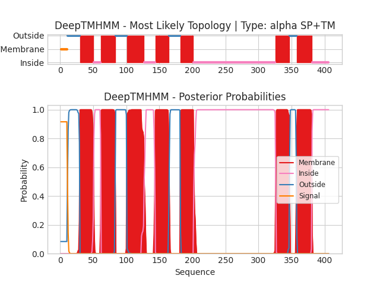

## DeepTMHMM - Predictions
Predicted topologies can be downloaded in [.gff3 format](TMRs.gff3) and [.3line format](predicted_topologies.3line)

You can download the probabilities used to generate this plot here（原引用 `sp|G1X9E2|GPR2_ARTOA_probs.csv` 在源目录未定位）
### Predicted Topologies
```
>sp|G1X9E2|GPR2_ARTOA | SP+TM
MTQLPYLLDRRGGALAAPATAWGDMMLNRALFSVALLSSVGSAWVVLSYACIKELRSYRHQLILGLAISDLLMSLNFMFSAGWNVAGGDLALEESRTACSVNGFLTQVFVVQTDWWILVIAIATYIILGNFKTQSQFIQTHVWIPWVGPWVLSIIIAAICHGVLGYGYIGGWCWLTSDLMRLLINFIPRWLIVIAIALIYIRLYMIVRKARKWDIEGVSPDPGDDMADTSVILMSVGKKDRERQGSGVLVSRDVSVSFGRKGSTAPTFVTMVTTSGAGDSREAISSCSAREEGSRARTVNVNSSRSLSLGMRQPLNAAQLKRIAKKMMVYPVAYAIIWACPTAIRIYQGTTGSRAPLWITIVDKSCIVIQGLVDAVVYGLNERAWQGWRDHIRRIIYKNEGGRIIG
SSSSSSSSSSOOOOOOOOOOOOOOOOOOOMMMMMMMMMMMMMMMMMMMMMIIIIIIIIIIIMMMMMMMMMMMMMMMMMMMMMMOOOOOOOOOOOOOOOOOMMMMMMMMMMMMMMMMMMMMMMMMMMIIIIIIIIIIIIIIIIIMMMMMMMMMMMMMMMMMMMMMOOOOOOOOOOOOOOOOOMMMMMMMMMMMMMMMMMMMMIIIIIIIIIIIIIIIIIIIIIIIIIIIIIIIIIIIIIIIIIIIIIIIIIIIIIIIIIIIIIIIIIIIIIIIIIIIIIIIIIIIIIIIIIIIIIIIIIIIIIIIIIIIIIIIIIIIIIIIIIIIIMMMMMMMMMMMMMMMMMMMMMOOOOOOOOOOOMMMMMMMMMMMMMMMMMMMMMMMIIIIIIIIIIIIIIIIIIIIIIIIII

```


```
##gff-version 3
# sp|G1X9E2|GPR2_ARTOA Length: 406
# sp|G1X9E2|GPR2_ARTOA Number of predicted TMRs: 7
sp|G1X9E2|GPR2_ARTOA	signal	1	10				
sp|G1X9E2|GPR2_ARTOA	outside	11	29				
sp|G1X9E2|GPR2_ARTOA	TMhelix	30	50				
sp|G1X9E2|GPR2_ARTOA	inside	51	61				
sp|G1X9E2|GPR2_ARTOA	TMhelix	62	83				
sp|G1X9E2|GPR2_ARTOA	outside	84	100				
sp|G1X9E2|GPR2_ARTOA	TMhelix	101	126				
sp|G1X9E2|GPR2_ARTOA	inside	127	143				
sp|G1X9E2|GPR2_ARTOA	TMhelix	144	164				
sp|G1X9E2|GPR2_ARTOA	outside	165	181				
sp|G1X9E2|GPR2_ARTOA	TMhelix	182	201				
sp|G1X9E2|GPR2_ARTOA	inside	202	325				
sp|G1X9E2|GPR2_ARTOA	TMhelix	326	346				
sp|G1X9E2|GPR2_ARTOA	outside	347	357				
sp|G1X9E2|GPR2_ARTOA	TMhelix	358	380				
sp|G1X9E2|GPR2_ARTOA	inside	381	406				

```
