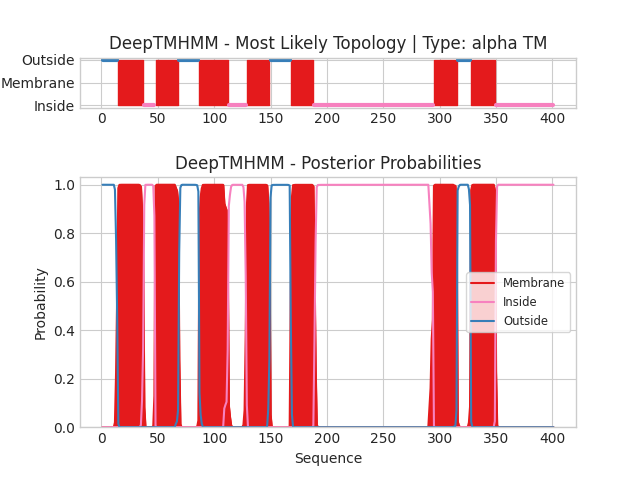

## DeepTMHMM - Predictions
Predicted topologies can be downloaded in [.gff3 format](TMRs.gff3) and [.3line format](predicted_topologies.3line)

You can download the probabilities used to generate this plot here（原引用 `sp|G1XJN1|GPR3_ARTOA_probs.csv` 在源目录未定位）
### Predicted Topologies
```
>sp|G1XJN1|GPR3_ARTOA | TM
MQPFGDAWSQRHLAGVVLAGSVLSIVGSLYMILGFFFLRECRSFRHKLILGLAVSDLLLALNFFIPSLSMVTGREISSPWNEGFCSANGFLMQLFFAQIDVWQISIALITLLMLSGPSMVLKWIRENVWAVWLFPWLVSLIAAFFAFGFWDYANVGGFCWLGSRNIRLYFNYIPRWIIILVCLVIYIAVYRLILHARRRANIQKTYRGRASDRAPPQPVTTTAPATNPESEKVNPDEISSGNGSSSLDTSRSGSSTGFTQTVHDPAVAGQIQTAAERAQEEAEQQKQVRKIAIQMISYPLAYAVLWAIPTIVMIIQVARGGEGVSIHVEGLAKMLLVFNGFVDAHVYGFNERTAMGWRQRIRPAAQEDDEEAAGTSGGVHEVVSRPEPTLKNPNVWQQNMV
OOOOOOOOOOOOOOMMMMMMMMMMMMMMMMMMMMMMMIIIIIIIIIIMMMMMMMMMMMMMMMMMMMMMOOOOOOOOOOOOOOOOOOMMMMMMMMMMMMMMMMMMMMMMMMMMIIIIIIIIIIIIIIIIMMMMMMMMMMMMMMMMMMMMMOOOOOOOOOOOOOOOOOOMMMMMMMMMMMMMMMMMMMMMIIIIIIIIIIIIIIIIIIIIIIIIIIIIIIIIIIIIIIIIIIIIIIIIIIIIIIIIIIIIIIIIIIIIIIIIIIIIIIIIIIIIIIIIIIIIIIIIIIIIIIIIIIMMMMMMMMMMMMMMMMMMMMMOOOOOOOOOOOOMMMMMMMMMMMMMMMMMMMMMMIIIIIIIIIIIIIIIIIIIIIIIIIIIIIIIIIIIIIIIIIIIIIIIIIIII

```


```
##gff-version 3
# sp|G1XJN1|GPR3_ARTOA Length: 401
# sp|G1XJN1|GPR3_ARTOA Number of predicted TMRs: 7
sp|G1XJN1|GPR3_ARTOA	outside	1	14				
sp|G1XJN1|GPR3_ARTOA	TMhelix	15	37				
sp|G1XJN1|GPR3_ARTOA	inside	38	47				
sp|G1XJN1|GPR3_ARTOA	TMhelix	48	68				
sp|G1XJN1|GPR3_ARTOA	outside	69	86				
sp|G1XJN1|GPR3_ARTOA	TMhelix	87	112				
sp|G1XJN1|GPR3_ARTOA	inside	113	128				
sp|G1XJN1|GPR3_ARTOA	TMhelix	129	149				
sp|G1XJN1|GPR3_ARTOA	outside	150	167				
sp|G1XJN1|GPR3_ARTOA	TMhelix	168	188				
sp|G1XJN1|GPR3_ARTOA	inside	189	294				
sp|G1XJN1|GPR3_ARTOA	TMhelix	295	315				
sp|G1XJN1|GPR3_ARTOA	outside	316	327				
sp|G1XJN1|GPR3_ARTOA	TMhelix	328	349				
sp|G1XJN1|GPR3_ARTOA	inside	350	401				

```
