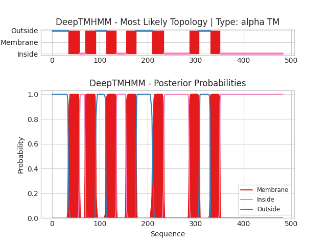

## DeepTMHMM - Predictions
Predicted topologies can be downloaded in [.gff3 format](TMRs.gff3) and [.3line format](predicted_topologies.3line)

You can download the probabilities used to generate this plot here（原引用 `NP_001309490.1_probs.csv` 在源目录未定位）
### Predicted Topologies
```
>NP_001309490.1 | TM
MDVIGNITDLSPTVSGIPDECGLEPHDFLEVKFFLISVVGTLIGLFGLFGNATTALILTRPSMRNPNNLFLTALAVFDSCLLITAFFIYAMEYIIEYTAAFDLYVAWLTYLRFAFALSHISQTGSVYITVAVTIERYLAVCHPKSSKNMCGPGGAAWTILGVTTFAVVFNCTKFFELQVTVNPSCPDGSNWQSYILLPSAMASNPIYQQVYSLWVTNFVMVFFPFLTLLLFNAIIAYTIRQSLEKYDFHNQKSVVAALSASVNLPRNIAGISSRNELKEKSREATLVLVIIVFIFLGCNFWGFVLTLLERIMGQETLMVEHHIFYTFSREAINFLAIINSSINFVIYLLFGKDFRKELVVVYGCGIRGISLRLPVQDKFVIWRHWKRTKSRISMNTTNRTRHKISLPQTLVEHANLERLEETRFLAHHEDGVQTQVSPIHALRNGSTPKIDTLQDLTSNGRPCKTSIIDDNGTVVCTVTEFP
OOOOOOOOOOOOOOOOOOOOOOOOOOOOOOOOOOMMMMMMMMMMMMMMMMMMMMMMMIIIIIIIIIIIIMMMMMMMMMMMMMMMMMMMMMMOOOOOOOOOOOOOOOOOOOOOMMMMMMMMMMMMMMMMMMMMMMIIIIIIIIIIIIIIIIIIIIMMMMMMMMMMMMMMMMMMMMMOOOOOOOOOOOOOOOOOOOOOOOOOOOOOOOOOOMMMMMMMMMMMMMMMMMMMMMMMMIIIIIIIIIIIIIIIIIIIIIIIIIIIIIIIIIIIIIIIIIIIIIIIIIIIIIMMMMMMMMMMMMMMMMMMMMMOOOOOOOOOOOOOOOOOOOOOOOMMMMMMMMMMMMMMMMMMMMIIIIIIIIIIIIIIIIIIIIIIIIIIIIIIIIIIIIIIIIIIIIIIIIIIIIIIIIIIIIIIIIIIIIIIIIIIIIIIIIIIIIIIIIIIIIIIIIIIIIIIIIIIIIIIIIIIIIIIIIIIIIIIIIIIII

```


```
##gff-version 3
# NP_001309490.1 Length: 482
# NP_001309490.1 Number of predicted TMRs: 7
NP_001309490.1	outside	1	34				
NP_001309490.1	TMhelix	35	57				
NP_001309490.1	inside	58	69				
NP_001309490.1	TMhelix	70	91				
NP_001309490.1	outside	92	112				
NP_001309490.1	TMhelix	113	134				
NP_001309490.1	inside	135	154				
NP_001309490.1	TMhelix	155	175				
NP_001309490.1	outside	176	209				
NP_001309490.1	TMhelix	210	233				
NP_001309490.1	inside	234	286				
NP_001309490.1	TMhelix	287	307				
NP_001309490.1	outside	308	330				
NP_001309490.1	TMhelix	331	350				
NP_001309490.1	inside	351	482				

```
