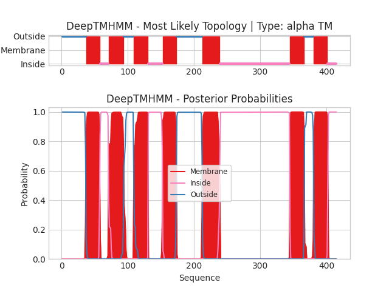

## DeepTMHMM - Predictions
Predicted topologies can be downloaded in [.gff3 format](TMRs.gff3) and [.3line format](predicted_topologies.3line)

You can download the probabilities used to generate this plot here（原引用 `NP_502887.1_probs.csv` 在源目录未定位）
### Predicted Topologies
```
>NP_502887.1 | TM
MLLPSNLTTSTLMTSSSESYDADNPGLPPEPILSDYVEMFTLVLNFIVGAPLNLAAYTQLSERPTSTRLDLLKRSLNYSDLLVLFIYVPSRACWLLTYDWRGGDALCKIVKMFHTFAFQSSSNVIVCIAVDRLLSVLSPSHHSPNKALKRTKMMLIVAWIVALVISCPQLFIWKAYLALPEYNWSQCLQIWEIARMEKFNKPQVVPEFDAEFWYSILHISLVFWIPCIIIMLSYIIVISWVWINSRPSIRHTSSFSFHTGCDTVDTVLTRASEWNPLKTFSRHVNIKEPEKPMTTPRIVVSDETEVPLTQRPSISPSEASAVMRTGVHTSTSYNANLNRSRALRVSLLLVVAYIICWLPYNLISLIQFLDRDFFSSYLKHVHFCQQLIIFNSVVNPWLYGFFGPRRPSTTGAGRH
OOOOOOOOOOOOOOOOOOOOOOOOOOOOOOOOOOOOMMMMMMMMMMMMMMMMMMMMMIIIIIIIIIIIIIMMMMMMMMMMMMMMMMMMMMMMMOOOOOOOOOOOOOOOMMMMMMMMMMMMMMMMMMMMMMIIIIIIIIIIIIIIIIIIIIIIMMMMMMMMMMMMMMMMMMMMMOOOOOOOOOOOOOOOOOOOOOOOOOOOOOOOOOOOOOOOMMMMMMMMMMMMMMMMMMMMMMMMMMIIIIIIIIIIIIIIIIIIIIIIIIIIIIIIIIIIIIIIIIIIIIIIIIIIIIIIIIIIIIIIIIIIIIIIIIIIIIIIIIIIIIIIIIIIIIIIIIIIIIIIIIIIMMMMMMMMMMMMMMMMMMMMMMOOOOOOOOOOOOOOMMMMMMMMMMMMMMMMMMMMMIIIIIIIIIIIIII

```


```
##gff-version 3
# NP_502887.1 Length: 415
# NP_502887.1 Number of predicted TMRs: 7
NP_502887.1	outside	1	36				
NP_502887.1	TMhelix	37	57				
NP_502887.1	inside	58	70				
NP_502887.1	TMhelix	71	93				
NP_502887.1	outside	94	108				
NP_502887.1	TMhelix	109	130				
NP_502887.1	inside	131	152				
NP_502887.1	TMhelix	153	173				
NP_502887.1	outside	174	212				
NP_502887.1	TMhelix	213	238				
NP_502887.1	inside	239	344				
NP_502887.1	TMhelix	345	366				
NP_502887.1	outside	367	380				
NP_502887.1	TMhelix	381	401				
NP_502887.1	inside	402	415				

```
