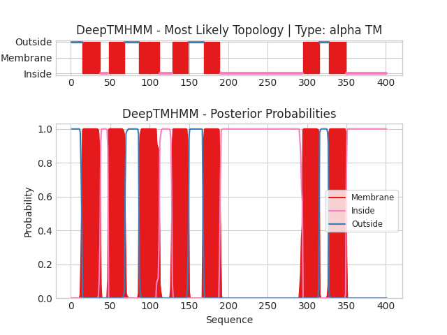

## DeepTMHMM - Predictions
Predicted topologies can be downloaded in [.gff3 format](TMRs.gff3) and [.3line format](predicted_topologies.3line)

You can download the probabilities used to generate this plot here（原引用 `TGJ67963.1_probs.csv` 在源目录未定位）
### Predicted Topologies
```
>TGJ67963.1 | TM
MQPFGDAWSQRHLAGVVLAGSVLSIVGSLYMILGFFFLRECRSFRHKLILGLAVSDLLLALNFFIPSLSMVIGREISSPWNEGFCSANGFLMQLFFAQIDVWQISIALITLLMLSGPSMVLKWIRENVWAVWLFPWLVSLIAAFFAFGFWDYANVGGFCWLGSRNIRLYFNYIPRWIVIFVCLVIYIAVYRLILHARRRANIQKTYRGRASDRAPPQPVTTTAPATNSESEKVNPDEISGVNGSSSLDTSRSGSSTGFTQTVHDPAVAGQIQTAAERAQEEAEQQKQVRKIAIQMISYPLAYAVLWAIPTIVMIIQVARGGEGVSIHVEGLAKMLLVFNGFVDAHVYGFNERTAMGWRQRIRPAAQEDDEEAAGTSGGVHEVVSRPEPTLKNPNVWQQNMV
OOOOOOOOOOOOOOMMMMMMMMMMMMMMMMMMMMMMMIIIIIIIIIIMMMMMMMMMMMMMMMMMMMMMOOOOOOOOOOOOOOOOOOMMMMMMMMMMMMMMMMMMMMMMMMMMIIIIIIIIIIIIIIIIMMMMMMMMMMMMMMMMMMMMMOOOOOOOOOOOOOOOOOOOMMMMMMMMMMMMMMMMMMMMMIIIIIIIIIIIIIIIIIIIIIIIIIIIIIIIIIIIIIIIIIIIIIIIIIIIIIIIIIIIIIIIIIIIIIIIIIIIIIIIIIIIIIIIIIIIIIIIIIIIIIIIIIMMMMMMMMMMMMMMMMMMMMMOOOOOOOOOOOOMMMMMMMMMMMMMMMMMMMMMMIIIIIIIIIIIIIIIIIIIIIIIIIIIIIIIIIIIIIIIIIIIIIIIIIIII

```


```
##gff-version 3
# TGJ67963.1 Length: 401
# TGJ67963.1 Number of predicted TMRs: 7
TGJ67963.1	outside	1	14				
TGJ67963.1	TMhelix	15	37				
TGJ67963.1	inside	38	47				
TGJ67963.1	TMhelix	48	68				
TGJ67963.1	outside	69	86				
TGJ67963.1	TMhelix	87	112				
TGJ67963.1	inside	113	128				
TGJ67963.1	TMhelix	129	149				
TGJ67963.1	outside	150	168				
TGJ67963.1	TMhelix	169	189				
TGJ67963.1	inside	190	294				
TGJ67963.1	TMhelix	295	315				
TGJ67963.1	outside	316	327				
TGJ67963.1	TMhelix	328	349				
TGJ67963.1	inside	350	401				

```
