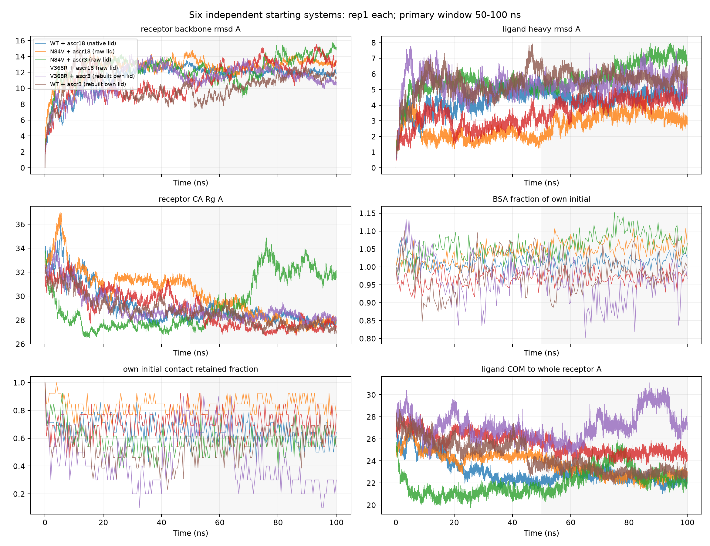
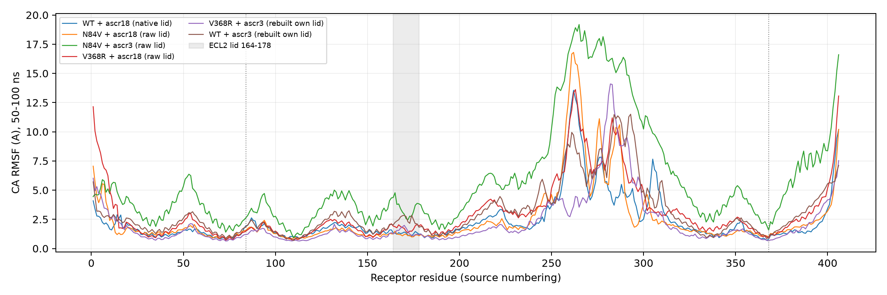
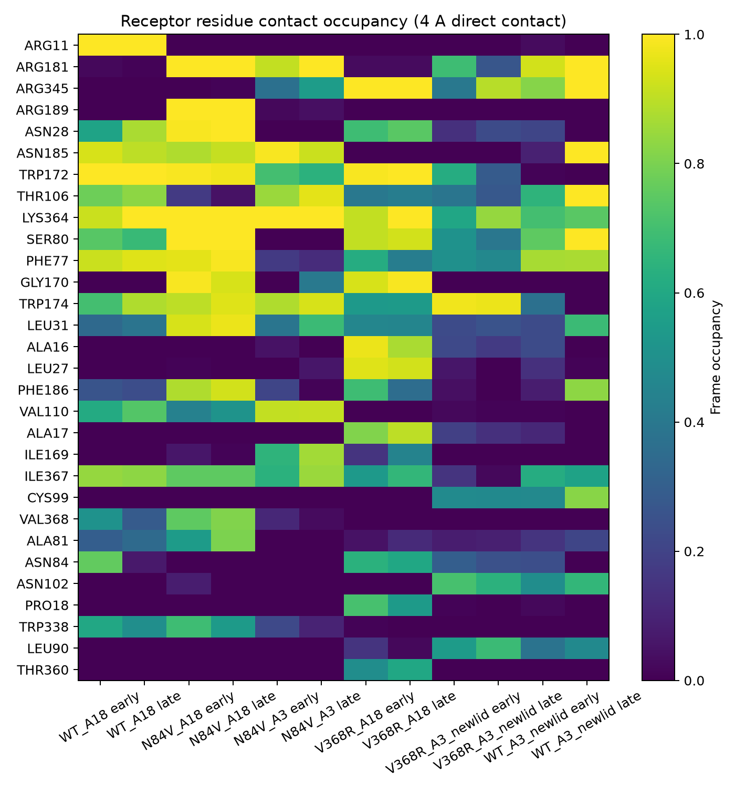

# Gpr2 TWF154 六组 rep1 × 100 ns：后分析与比较报告

交付日期：2026-10-09（北京时间）。任务沿 10 月 8 日命名的 `analysis-20261008/` 目录保存；本轮 E2 后处理与共享指标实际执行于 10 月 9 日凌晨。

**六组均完成后处理、七类共享指标和比较验收。** 每组 processed 轨迹含受体与配体，覆盖 0–100000 ps、10001 个唯一时间点。42 次共享 driver 实际退出均为 0，180 项指标内容检查、60 项独立 RMSD 复算和 48 项动态接触交叉检查全部通过。本地回收的 633 份 E2 小文件逐份大小和 SHA256 一致；24 份派生 XTC 共约 37.09 GB 留在 E2。[总验收](evidence/final_acceptance.json) 汇集实际证据，不能替代原生产门禁。

这些结果描述各自实际母体、lid、pose 和准备过程下的一条轨迹。它们可用于比较本轮观测到的运动、埋藏与接触变化，**不能确立突变因果、亲和力顺序或偏好机制**。全程受体构象变化明显，后半程仍有漂移；选取 50–100 ns 不表示已经达到平衡。

## 六组身份与输入验收

| 报告简称 | case_id | 母体与 lid | 正式段数 | 全体系原子 | processed 原子 |
|---|---|---|---:|---:|---:|
| WT–ascr18 | native_wt_ascr18 | 独立 WT；native lid，已有 W174 侧链修复 | 15 | 145776 | 6454 |
| N84V–ascr18 | raw_n84v_ascr18 | 自身 N84V AF3；raw lid | 12 | 146032 | 6456 |
| N84V–ascr3 | raw_n84v_ascr3 | 自身 N84V AF3；raw lid | 13 | 146021 | 6448 |
| V368R–ascr18 | raw_v368r_ascr18 | 自身 V368R AF3；raw lid | 13 | 145979 | 6462 |
| V368R–ascr3 新 lid | v368r_ascr3_lid_rebuilt_own_pose_v1 | 自身 V368R 母体/pose 下的 lid 重构 | 12 | 145905 | 6454 |
| WT–ascr3 新 lid | native_wt_ascr3_lid_rebuilt_own_pose_v1 | 独立 WT 母体/pose 下的 lid 重构 | 12 | 145681 | 6446 |

各组采用自己的 top1 pose，随后经历自己的准备过程。WT 不来自突变体回变，也不是历史 WT 200 ns 项目。受体均 406 位、拟合主链均 1623 原子；ascr18 为 54 原子/23 重原子，ascr3 为 46 原子/21 重原子。完整身份、来源哈希和指针见[母体/pose 溯源](configs/parent_pose_provenance.json)、[原输入选择](../../input-selection-20261005/provenance.json)及逐组 `input_contract.json`。

复用 [77 段逐文件回收凭证](../recovery/E2_VERIFIED_COVERAGE_20261007T2250Z.json)，本轮补查 manifest/闭合记录/TPR 的 SHA、源 XTC 字节数、所有帧的原子数、有限坐标和时间并集。原大 XTC 的旧 SHA 未重新全量计算，当前检查范围详见 [METHODS](METHODS.md)。按实际闭合记录排序后合并正式段；没有混入资格、预热、NPT 或旧 E2 快照。N84V–ascr18 的 1030 ps、WT–ascr3 新 lid 的 26970 ps 各重复一次，重复帧坐标最大差异均为 0 nm；仅派生合并副本去重。六组合并及 processed 均重新验收为 10001 帧。

| 组合 | 最大重原子共价键 / Å | 最大相邻 CA / Å | 最大配体相对受体 COM 的 10 ps 位移 / Å | 输入、映射、PBC |
|---|---:|---:|---:|---|
| WT–ascr18 | 2.174 | 4.148 | 1.356 | PASS |
| N84V–ascr18 | 2.200 | 4.190 | 1.251 | PASS |
| N84V–ascr3 | 2.196 | 4.125 | 1.731 | PASS |
| V368R–ascr18 | 2.166 | 4.173 | 1.544 | PASS |
| V368R–ascr3 新 lid | 2.163 | 4.138 | 1.880 | PASS |
| WT–ascr3 新 lid | 2.189 | 4.136 | 2.307 | PASS |

上限为 3.0、4.5、10.0 Å，只用于筛查原子错配、分子断裂和 PBC 跳跃，不是结合稳定性判据。[输入与处理验收表](evidence/input_processed_validation.tsv) 指向逐组原始验证 JSON；每组还有全部帧的 `pbc_sanity.csv/png`。

首次严格映射检查识别到 GROMACS PDB 将 `ASCR18/ASCR3` 写为四字符 `ASCR`，六组在此检查处停止。修复后只接受确切的四字符截断，继续严格核对所有原子名称、次序、残基号、受体残基名及 reduced TPR 身份，并重新执行全帧 PBC 验收。旧失败日志保留，最终状态见 `processed_validation.json`、`driver_completion.json` 和本轮内容验收，不能用早期失败或批队列退出码单独判定交付。

## 比较口径

主要窗口统一 **50–100 ns，含端点**；密集指标取 5001 帧，0.5 ns 采样指标取 101 帧。全程密集指标为 10001 帧、稀疏指标为 201 帧。RMSF 使用后半程 5001 帧的平均结构；氢键和接触占有率分母为同一窗口的 101 个时点。每组明确设置 `CHIMERIC_MD_REPS=1`。历史 after100 默认汇总没有用于本轮。

以下表中的均值是同一条轨迹的时间描述；相关帧、101 个采样点和 10 ns 时间块都不构成独立生物重复。完整均值、范围、时间标准差与趋势见[逐窗口统计](comparison/time_series_statistics.csv)，10 ns 描述见[时间块表](comparison/ten_ns_blocks.csv)。未使用稳定/不稳定分类阈值，没有综合分或排名。选择、公式、采样及环境详见 [METHODS](METHODS.md)。

## 七类指标的六组结果

表中各项均为 50–100 ns 时间均值；BSA 采用 `SASA(受体)+SASA(配体)−SASA(复合物)`，不除以 2。BSA 比例及初始接触保留比例都相对于本组生产 frame0。

| 组合 | 受体主链 RMSD / Å | 受体 CA Rg / Å | 配体重原子 RMSD / Å | BSA / Ų | BSA / 自身初始 | 初始接触保留比例 |
|---|---:|---:|---:|---:|---:|---:|
| WT–ascr18 | 12.01 | 28.28 | 4.54 | 920.6 | 1.014 | 0.622 |
| N84V–ascr18 | 12.99 | 28.55 | 3.20 | 913.7 | 1.058 | 0.839 |
| N84V–ascr3 | 12.78 | 30.80 | 6.19 | 792.0 | 1.079 | 0.586 |
| V368R–ascr18 | 12.63 | 27.63 | 4.18 | 953.4 | 0.970 | 0.710 |
| V368R–ascr3 新 lid | 11.69 | 28.36 | 5.52 | 745.4 | 0.943 | 0.436 |
| WT–ascr3 新 lid | 10.56 | 27.92 | 5.77 | 758.1 | 0.983 | 0.577 |

配体 RMSD 是受体主链拟合后相对于本组生产初始配体的重原子 RMSD。ascr18/ascr3 原子集合不同；生产初始态也不等于 docking 原始坐标。N84V–ascr18 在本条轨迹中保留了更多自己的初始接触、配体 RMSD 较小，说明这条起点下相对于自身初始接触区的变化较少；它不证明 N84V 提高了 ascr18 亲和力。N84V–ascr3 的 BSA 比例增大，同时配体 RMSD 较大，说明埋藏程度与相对初始 pose 的位移回答不同问题。

图 1：六组各一条 100 ns 轨迹；灰色区域为主要窗口。受体主链 RMSD 均达到较大幅度，曲线不能仅凭 driver 名称称为“收敛”。N84V–ascr3 在约 70 ns 后的 Rg 明显变化，50–100 ns 线性趋势为 +0.112 Å/ns；WT–ascr3 新 lid 的受体 RMSD 趋势为 +0.078 Å/ns。时间趋势用于识别持续变化，不作为平衡检验或显著性检验。其他组的小线性斜率也不能排除局部变化。

| 组合 | 配体 COM 至全受体 COM / Å | 406 位 CA RMSF 的均值 / Å | RMSF 最大值 / Å（残基） | ECL2 lid 164–178 的 CA RMSF 均值 / Å | 最大几何候选氢键占有率 |
|---|---:|---:|---:|---:|---:|
| WT–ascr18 | 22.53 | 2.36 | 13.55（262） | 1.28 | 0.950 |
| N84V–ascr18 | 22.89 | 2.48 | 16.80（262） | 1.17 | 0.683 |
| N84V–ascr3 | 22.73 | 5.75 | 19.19（265） | 3.42 | 0.238 |
| V368R–ascr18 | 24.83 | 3.07 | 13.62（263） | 1.76 | 0.752 |
| V368R–ascr3 新 lid | 27.24 | 2.17 | 14.10（282） | 1.44 | 0.564 |
| WT–ascr3 新 lid | 23.18 | 3.06 | 11.50（293） | 2.40 | 0.891 |

全受体 COM 还受侧链质量与受体构象影响，不能直接当成同一口袋中心。各组另有“配体至自身初始 4 Å 接触残基簇 COM”的全程输出，主要用于组内迁移；六组初始簇不同，不将该距离用于匹配口袋的排名。

图 2：50–100 ns 的受体 CA RMSF，灰带标示 lid 164–178，虚线为 84 和 368 位。各组最大波动位点位于 262–293 范围；N84V–ascr3 的波动还覆盖较多其他残基。整体拟合与这些区域的运动会影响 RMSD、Rg 和拟合后的配体位置。本结果没有进一步证明某一环区的功能机制，局部结构复核可沿 [RMSF 数值表](comparison/receptor_RMSF_50_100ns.csv) 定位。

最大占有率的候选氢键分别是：WT–ascr18 `ARG11 NH1–HH12 → 配体 O5`，N84V–ascr18 `ARG189 NH1–HH12 → O6`，N84V–ascr3 `ARG181 NH2–HH21 → O5`，V368R–ascr18 `ARG345 NH2–HH21 → O6`，V368R–ascr3 新 lid `ARG345 NH2–HH22 → O6`，WT–ascr3 新 lid `ARG345 NH2–HH21 → O5`。共享 driver 用供体–受体 ≤3 Å、D–H–A ≥150°及首帧近邻供体–H配对做手工几何扫描；这些占有率没有完整化学类型验证，只报告为候选几何事件。完整配对、事件时间与 101 帧分母留在每组 `analysis/hbond/`。

## 初始接触变化与新增接触

初始接触保留比例只统计各自 frame0 的残基接触集合；六组初始集合大小依次为 14、13、13、13、10、13。已有共享 ligand-path driver 另在共同 WT–ascr18 frame0 受体坐标系中拟合，统计全部动态接触和配体重原子几何质心运动。共同坐标系未消除母体、lid 或 pose 差异，也不能把绝对位置差异解释为突变效应。

| 组合 | 几何质心相对自身初始位置的平均位移 / Å | 动态直接接触残基数均值 | 相对于 frame0 新增接触的示例及后半程占有率 |
|---|---:|---:|---|
| WT–ascr18 | 4.32 | 11.53 | ASN28 0.871；ILE367 0.832 |
| N84V–ascr18 | 2.56 | 15.75 | LEU31 0.970；PHE186 0.931 |
| N84V–ascr3 | 4.41 | 11.06 | ILE367 0.851；LEU31 0.683 |
| V368R–ascr18 | 3.48 | 14.13 | ALA16 0.871；ASN28 0.743 |
| V368R–ascr3 新 lid | 4.64 | 8.64 | ARG345 0.891；ASN102 0.644 |
| WT–ascr3 新 lid | 5.01 | 11.81 | ASN185 1.000；PHE186 0.832 |

示例是动态表中“不是 frame0 接触”的两个观测残基，不是预注册机制候选。V368R–ascr3 新 lid 的初始接触保留较低，同时存在新增 ARG345/ASN102 接触，说明只看初始接触保留会遗漏接触区重排。六组后半程 101 个采样时点均仍有至少一个 ≤4 Å 的受体直接接触；最短受体–配体重原子距离范围合并为 2.466–3.523 Å。这不等于保持了原始口袋或证明未发生功能性解离。

图 3：按六组固定顺序展示，early 为 0≤t<50 ns 的 100 点，late 为 50≤t≤100 ns 的 101 点；热图仅显示所有组中占有率较高的 30 个残基标签。完整动态表保留全部观察到的残基。`ASN84/VAL84`、`VAL368/ARG368` 是各体系自身残基身份，不能将未入图或未出现某标签当作对应编号缺失。

路径、全部动态接触及代表帧索引见 [centroid_path.csv](comparison/ligand_paths/centroid_path.csv)、[residue_contact_occupancy.csv](comparison/ligand_paths/residue_contact_occupancy.csv)、[representative_frames.csv](comparison/ligand_paths/representative_frames.csv)。代表帧表提供 0、50、75、最大位移和末帧的位置索引，不包含额外导出的结构快照。共同参考下的路径见 [路径投影图](comparison/ligand_paths/matched_centroid_path_common_frame.png)。

## 验证、复现与文件使用

验收没有依赖“命令成功”一项：六组检查全部原/合并/processed 时间网格及原子映射；180 项数值表检查覆盖有限值、行数、时间点、RMSD frame0、BSA 与接触比例复算、RMSF 残基映射及占有率分母。独立 NumPy SVD 在各组 0/25/50/75/100 ns 分别复算主链和配体 RMSD，共 60 项，最大差异 2.678×10⁻⁶ Å（验收容差 10⁻⁴ Å）。动态接触另从 frame contact 记录重建占有率，并与七类 driver 的接触保留数和初始接触占有率逐时点交叉核对，48 项通过。

- [180 项内容验收](comparison/analysis_validation.tsv)、[独立 RMSD 复算](comparison/independent_rmsd_reproduction.csv)、[48 项路径/接触交叉检查](evidence/ligand_path_validation.tsv)。
- [633 份小文件回收校验](evidence/local_delivery_validation.tsv)、[E2 全部产物清单](evidence/e2_artifacts.tsv)、[24 份保留轨迹清单](evidence/retained_e2_trajectories.tsv)。清单包含实际绝对路径、字节数和 SHA256。
- [本轮批次配置](configs/batch_config_v3.json)、逐组 `e2_delivery/<case_id>/system_config.json`、[实际部署源码 v3](configs/deployed_source_v3/)、`e2_delivery/_shared/evidence/` 的环境与持久队列日志。初次部署源码和失败记录单独保留；原部署 SHA 文件代表当次快照，最终源码身份以冻结产物清单为准。

E2 原生产与本轮工具均从真实日志/版本输出确认为 GROMACS 2025.4-conda_forge；分析独立 Python 3.11.17 环境使用 MDAnalysis 2.10.0、mdtraj 1.11.1。共享窗口接口的 14 项相关测试通过。持久队列降低 CPU 优先级，每队列限制 2 个计算线程；本轮没有启动 MD、使用 GPU、修改原始 `runs/`/`operator_records/`、操作既有 E2 MD 或恢复定时任务。资源快照保留了既有两条 MD 仍在运行的事实，不把整机负载归因于本轮分析。

大文件位于 `nkuliulab-e2:/ifs1/User/dengwei/igem/md/gpr2-autodl/analysis/<case_id>/`：`merged_full.xtc` 为全体系合并副本；`processed/rep1/prod_whole.xtc`、`prod_cluster.xtc`、`prod_protein.xtc` 分别为 whole、nojump、受体主链拟合后的受体+配体轨迹。共享接口名 `prod_protein` 包含配体；`prod_cluster` 本轮实际采用 nojump。使用本组 `processed/rep1/solution.tpr` 或 `protein_ref.pdb`，不得跨组配对。本地已回收这些小型拓扑/参考文件。

建议先读本报告和[六组汇总 CSV](comparison/six_case_summary.csv)，按问题查看全程/10 ns 块/残基和接触表，再沿代表帧索引到 E2 做结构复核。若研究问题需要判定突变因果或偏好机制，仍缺少控制起点差异的比较设计、独立重复及相应功能/亲和力证据；本轮没有自动追加计算或提出已经验证的突变方案。

所引：本报告上方所列真实表格、验证与源码；[方法](METHODS.md)、[E2 输入树](../E2_FILE_TREE.md)、[六组生产与回收凭证](../recovery/ALL_SIX_100NS_E2_COMPLETE_20261007T2250Z.json)、[当前输入来源](../../input-selection-20261005/provenance.json)。被引：本目录 README、Gpr2 结果总入口、生产回收入口、[INDEX](../../../../../../docs/INDEX.md) 和 [10 月 9 日日志](../../../../../../docs/logs/2026-10-09.md)；其他下游引用未穷尽检索。
