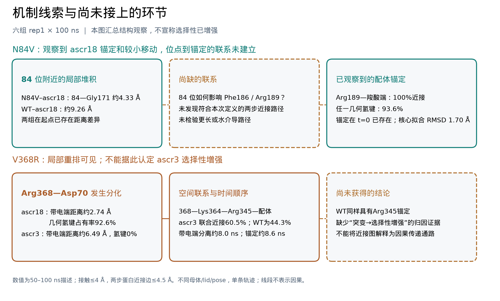
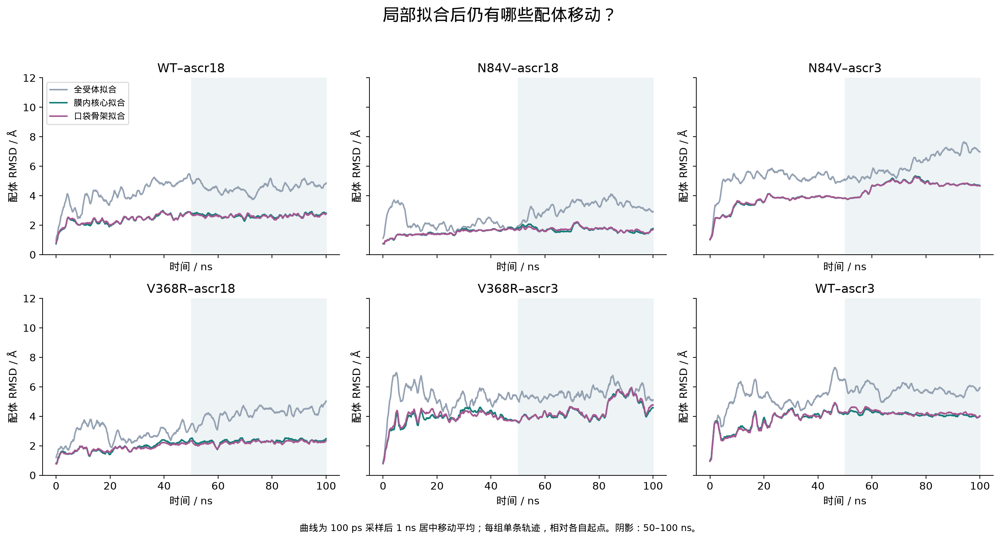
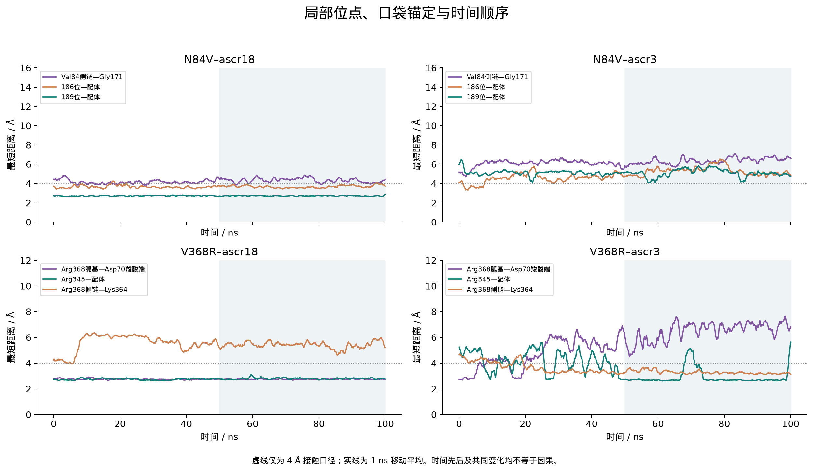
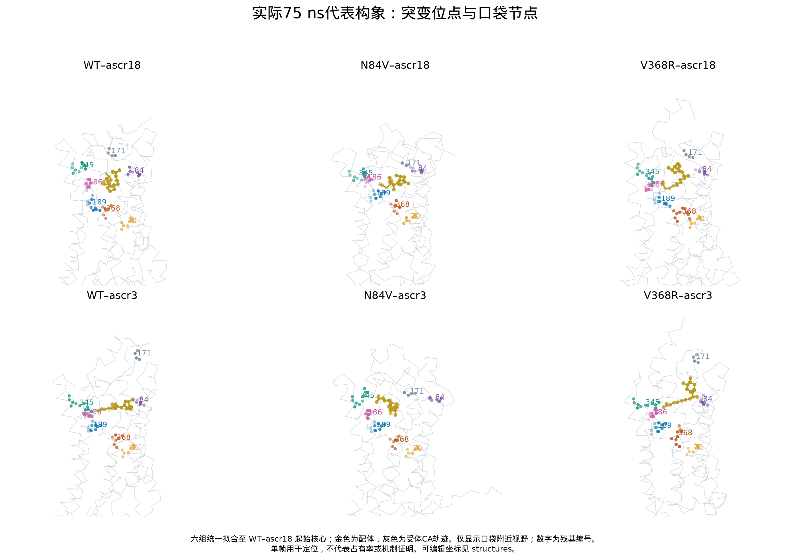

# Gpr2 TWF154：N84V、V368R 与口袋接触变化的机制复核

日期：2026-10-10。来源为既有六组 rep1 × 100 ns 轨迹；本次仅补充后分析。

**现有轨迹给出了两类具体结构线索，但没有建立“突变增强配体选择性”的完整机制。** N84V–ascr18 中，Arg189 持续锚定配体羧酸端，配体相对口袋的移动较小；然而这项锚定在生产起点已存在，尚未找到从 84 位通向该锚点的具体传递联系。V368R 的两条轨迹显示 Arg368–Asp70 带电基团的不同状态，并伴随口袋接触重排；该过程与一个局部重排假说相容，但 WT 同样具有主要配体锚点，无法据此归因为突变造成的选择性增强。

图 1 将已观察到的结构、候选联系和未获支持的结论分别显示。线段表示讨论的联系，不表示因果或能量传递。可编辑版本为 [SVG](figures/mechanism_evidence_map.svg)，印刷版为 [PDF](figures/mechanism_evidence_map.pdf)。

## 1. N84V：锚定方式明确，84 位到锚点的联系未建立

N84V–ascr18 的 Arg189 胍基靠近配体末端羧酸盐，50–100 ns 的重原子接触占有率为 **100%**；每个时点只计一次的“任一候选几何氢键”占有率为 **93.6%**。主要原子对是 Arg189 NH1/NH2 与配体 O6。这比“接触数量更多”更具体：轨迹中存在一个位置明确、几何持续的羧酸端锚点。

Phe186 也靠近同一羧酸端，接触占有率 **87.4%**。它主要以芳环碳接近羧酸氧，不能把这种近接称为氢键，也不能仅凭 Phe 是疏水残基就写成“疏水作用增强”。WT–ascr18 中 Phe186 的主要接触对象反而是糖环相连的甲基，所比较的接触化学环境并不相同。

| 50–100 ns 接触描述 | WT–ascr18 | N84V–ascr18 | WT–ascr3 | N84V–ascr3 |
|---|---:|---:|---:|---:|
| Phe186–配体，≤4 Å | 25.1% | 87.4% | 79.0% | 0.8% |
| Arg189–配体，≤4 Å | 0% | 100% | 0% | 4.4% |
| Arg189–配体，任一几何氢键 | 0% | 93.6% | 0% | 0% |

本次使用 100 ps 采样，因而占有率与此前 500 ps 表格略有差别；取回相同的 500 ps 时点后，36 项对应接触占有率全部复现。不能把采样密度变化当作结构结论变化。[原子基团表](tables/anchor_group_occupancy.csv)、[氢键并集表](tables/anchor_hbond_union.csv)、[距离口径表](tables/anchor_sensitivity.csv)。

**84 位附近确有可定位的差异，但还不足以连接到 Arg189。** N84V–ascr18 的 Val84 侧链至 lid 内 Gly171 的平均最短距离为 **4.33 Å**，WT–ascr18 为 **9.26 Å**，N84V–ascr3 为 **6.36 Å**。不过，N84V–ascr18 的 84–171 起点距离已是 4.37 Å，WT 为 6.63 Å；后期接触对距离口径也敏感：3.5、4.0、4.5 Å 下分别为 1.2%、20.6%、66.1%。因此可以说该轨迹中 Val84 与 lid 更接近，不能称为一个已经确认的持续强相互作用。

对 84 位至 Phe186／Arg189 的同时两步非相邻残基近接检查，没有找到符合本次定义的连接。它只说明“未找到一条短距离、两条边的具体联系”，不排除更长路径或水介导作用。Val84 在后半程也没有直接接触配体。

时间上，Arg189 的配体锚定从 **t=0** 就已存在，Phe186 的首个至少持续 1 ns 的接触区段从 **0.1 ns** 开始。现有轨迹没有呈现清楚的“84 位先变化，然后锚点才形成”的过程。**可保留的假说是：该 N84V 起始构象下的 lid/口袋排列与 ascr18 羧酸端锚定相容；不能写成 N84V 已被证明通过 Phe186/Arg189 增强选择性。**

## 2. V368R：局部重排可见，锚定不是突变体独有

Arg368 在两组 V368R 起点均与 Asp70 近接。精确检查 Arg368 的 NE/NH1/NH2 与 Asp70 的 OD1/OD2 后，发现后半程状态明显不同：

| 50–100 ns 描述 | V368R–ascr18 | V368R–ascr3 |
|---|---:|---:|
| Arg368 带电端–Asp70 羧酸端平均最短距离 | 2.74 Å | 6.49 Å |
| 两者任一候选几何氢键占有率 | 92.6% | 0% |
| Arg368 侧链–Lys364 重原子接触占有率，≤4 Å | 0.4% | 97.4% |
| Arg345–配体接触占有率，≤4 Å | 100% | 90.4% |

ascr18 轨迹保留了符合离子性氢键几何的 Arg368–Asp70 联系；ascr3 轨迹中带电端移开，同时 Arg368 较靠近 Lys364。后者最常见的最近原子对为 **Arg368 CG 与 Lys364 主链 O**，不能称为 Arg–Lys 两个正电侧链形成盐桥。

在 ascr3 轨迹中，还观察到“368 侧链—Lys364—Arg345—配体”的同时空间近接，后半程联合占有率为 **60.5%**。WT–ascr3 同一编号路径为 **44.3%**，并非突变体独有。该图描述蛋白的几何邻接；它没有测得沿路径的能量或信号传递。[两步空间连接](tables/proximity_bridges.csv)、[局部原子对](tables/local_pair_summary.csv)。

**时间顺序允许一个重排假说，但不能确立因果。** V368R–ascr3 中，Arg368 带电端至 Asp70 距离超过 4 Å 的首个至少 1 ns 区段始于 **8.0 ns**；Arg345 至配体 ≤4 Å 的对应首个区段始于 **8.6 ns**。二者时间接近，与“局部排列改变并伴随配体重新锚定”相容，但单条相关轨迹不能确定前者导致后者。

这里必须区分两个距离：以 Arg368 **整个侧链的任意原子**计算，持续离开 Asp70 的时间为 22.3 ns；以**带电端**计算则为 8.0 ns。前者不能作为盐桥几何丢失的时间。本报告与最终机制图采用带电端定义，纠正了初步口头解读中的混用。[精确化学几何](tables/Arg368_Asp70_summary.csv)、[事件表](tables/event_timeline.csv)。

同时，WT–ascr3 的 Arg345–羧酸端锚定也很持久：接触为 **100%**，任一候选氢键为 **94.0%**；V368R–ascr3 对应为 **90.4%**、**87.0%**。因此，现有结果不支持“V368R 新增或增强 Arg345 锚定，从而增强 ascr3 选择性”的具体解释。可保留的是一个**配体/起点相关的受体局部重排模型**，其与突变及选择性的因果关系未建立。

## 3. 口袋与 lid：局部拟合改变了部分原始印象

采用起始帧确定、六组共有的膜内螺旋核心和口袋骨架重新拟合，仍能看到 N84V–ascr18 较小的配体移动；它并非全部来自全受体拟合方式。但这些量仍是相对各自起始位姿的运动，不能当作亲和力读数。

| 50–100 ns 均值 / Å | 配体 RMSD：全受体拟合 | 配体 RMSD：膜内核心拟合 | 配体 RMSD：口袋拟合 | lid RMSD：膜内核心拟合 |
|---|---:|---:|---:|---:|
| WT–ascr18 | 4.56 | 2.65 | 2.62 | 1.38 |
| N84V–ascr18 | 3.21 | 1.70 | 1.73 | 0.98 |
| N84V–ascr3 | 6.18 | 4.70 | 4.68 | 1.34 |
| V368R–ascr18 | 4.19 | 2.32 | 2.22 | 2.13 |
| V368R–ascr3 新 lid | 5.54 | 4.42 | 4.47 | 3.29 |
| WT–ascr3 新 lid | 5.77 | 4.15 | 4.23 | 4.34 |

特别是 N84V–ascr3：lid 相对起点的主链 RMSD 在全受体拟合下为 **6.41 Å**，膜内核心拟合后为 **1.34 Å**。因此不能把全受体参考下的大幅 lid 运动直接解释成局部开口失稳。与此同时，ascr3 在局部口袋参考中的配体移动仍较大，说明配体重定位这一观察并未消失。三种拟合没有把差异“修成”统一结论。[完整汇总](tables/six_case_local_summary.csv)、[lid 几何图](figures/lid_geometry.png)。

时间图同时展示位点、口袋与配体。图中平滑仅供阅读，事件时间和占有率均从未经平滑的 100 ps 采样值计算。曲线不表示独立重复或因果方向。

代表图固定使用 75 ns，统一对齐至 WT–ascr18 起始核心，仅用于定位。每组 0、10、25、50、75、100 ns 的实际坐标均保存在 [structures](structures/README.md)，可以复核起点与后期差异。

## 4. 本批数据最终能支持到哪里

- **有直接结构观察支持**：N84V–ascr18 的 Arg189–羧酸端锚定、较小局部配体移动；两个 V368R 体系的 Arg368–Asp70 几何状态分化及不同局部堆积。
- **可作为候选解释**：N84V 起始构象中的 lid/口袋排列与 ascr18 锚定相容；V368R–ascr3 存在带电端分离和口袋重新锚定时间相近的重排过程。
- **目前支持不了**：84 位经具体路径驱动 Arg189 锚定；V368R 特异增强 Arg345 锚定；任一突变已经增强 ascr18/ascr3 选择性或亲和力。起点、lid 处理与 pose 不匹配及单重复仍是归因限制。

四项后分析均有实际数值输出，未把“没有找到支持”改写为成功机制。逐命题状态、反例和来源见 [中文证据表](EVIDENCE_TABLE.md)及 [CSV](tables/mechanism_evidence.csv)。方法、选择与检查边界见 [METHODS](METHODS.md)；总验收、E2 路径及哈希见 [交付入口](README.md)。

所引：上述本轮表格、真实代表结构、独立数值检查，以及上一轮输入/后处理证据。被引：本轮 README、Gpr2 结果总入口、项目 INDEX 和 2026-10-10 日志；其他下游引用未穷尽检索。
